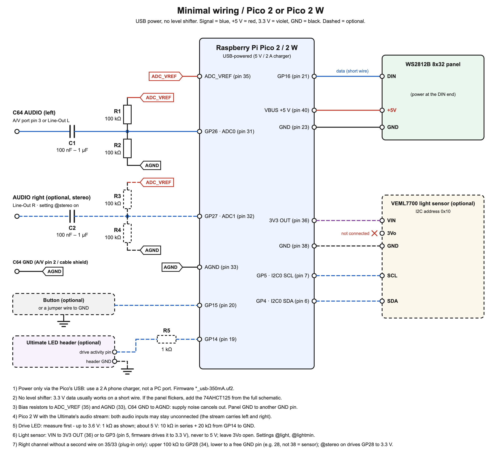

# C64 Sound Visualizer – Pico 2 + WS2812B 8x32 RGB matrix

*Deutsche Version: [README_DE.md](README_DE.md)*

**User manual (German):** [docs/HANDBUCH.md](docs/HANDBUCH.md) – operation, web page, every setting and code,
troubleshooting. The same manual is the **Hilfe** tab of the web page and of the offline editor.

Turns the sound of a Commodore 64 into a live light show on an 8x32 RGB LED matrix.
Runs on a **Raspberry Pi Pico 2 (RP2350)**, written in C with the Pico SDK.

- **Seventeen visualizer modes**, all driven by the same 512-point FFT (16 bands, 100 Hz – 6 kHz):
  `spectrum` (green/yellow/red bars with falling peak dots), `vu` (level meter), `mirror` (bass in the centre, rainbow,
  up and down), `waterfall` (spectrogram scrolling left, bass at the bottom), `scope` (the waveform itself with afterglow),
  `fire` (flames fed by the frequency bands), `plasma` (demoscene plasma), `starfield` (stars flying outwards),
  `raster` (C64 raster bars)
- **Automatic or button switching** of the modes, set in `texts.txt` and toggled by holding the button for 3 s
- **One button** – short press = next mode, hold 0.7–3 s = brightness (7 / 20 / 45 / 100 %), hold 3 s = automatic/button switching
- **Adaptive levels** – the display follows both the peaks and the average of the music, so quiet passages sit low and
  peaks reach the top, whatever the volume
- **Smooth 62 fps** – the audio is recorded continuously by DMA (no gaps), each analysis window overlaps the previous one
  by half, and the LEDs are sent by DMA in the background
- **Gamma-corrected, dithered LEDs** – fades and dim pixels (fire, waterfall, afterglow) look like on a screen, without
  coarse brightness steps or colour shifts
- **Automatic gain control**, noise gate, clipping warning (magenta pixel top-right)
- **Idle texts** with control codes (blink, glow, explode, colour, rainbow, pause) from a text file, shown when there is no sound
- Also builds for **MAX7219** 8x8 modules (single 8x8 or 4-in-1 8x32) – see [Display variants](#display-variants)

## Pictures

<p></p>
<p>


</p>

*Top: some of the 17 modes on the matrix. Bottom: the web page of the Pico 2 W (in German) – control with “devices in
the network”, scrolling texts with preview, the setup assistant for chaining several devices.*

> **Guide for all three devices together** (visualizer, audio receiver, Raspberry Pi jukebox – setup, chaining,
> operation, illustrated): [docs/Guide_C64-Ecosystem.pdf](docs/Guide_C64-Ecosystem.pdf) – German version:
> [docs/Anleitung_C64-Oekosystem.pdf](docs/Anleitung_C64-Oekosystem.pdf)

## What was verified – and what was not

| Verified | Not verified |
|---|---|
| All firmware variants build for `rp2350-arm-s` (Pico SDK 2.1.1); host tests of the firmware (`tests/run_host_tests.sh`) and browser tests of the web page (`tests/web/`) run on the PC | **Only tested by the author:** Pico 2 W with WS2812B 8x32 in the author's home network, audio from an Ultimate 64 Elite II (analogue and as network stream). Other routers, WLANs and Ultimate firmwares may behave differently (e.g. multicast, see [WLAN firmware](#wlan-firmware-pico-2-w)) |
| Signal processing tested on a PC with synthetic tones and noise (tones land in the right band, silence stays dark) | Panel orientation defaults are educated guesses → use the boot animation + `config.h` flags (see [Calibration](#calibration)) |
| Column-major serpentine LED mapping checked | Exact signal level of *your* C64 → adjust with the pot P1 |

## Minimal build (recommended to start with)



Three passive parts and USB power, same firmware. Trade-offs: less maximum brightness (USB), no level shifter
(3.3 V data usually works on a short wire), no protection parts (fine for the A/V-port signal, not for a raw SID-pin tap).

| Qty | Part |
|---|---|
| 1 | Raspberry Pi Pico 2 or Pico 2 W (with headers) |
| 1 | WS2812B 8x32 matrix |
| 1 | capacitor 100 nF – 1 µF, ceramic or film (C1) |
| 2 | 100 kΩ resistor (R1, R2) |
| 1 | push button (or a jumper wire GP15 → GND) |
| 1 | USB phone charger 5 V / 2 A + Micro-USB cable |
| – | breadboard, jumper wires |
| optional | stereo: a second capacitor (C2) + 2 × 100 kΩ (R3, R4) at GP27 |
| optional | drive LED of the Ultimate: 1 kΩ (R5) at GP14 |
| optional | VEML7700 light sensor on I2C (GP4/GP5, 3V3) for automatic brightness – case in `case/` |

With the Pico 2 W and the Ultimate's audio stream, the audio parts (C1, R1, R2 and the stereo set) are not needed.
The drawing is generated by `docs/make_schematic_minimal.py` (German version: `docs/schematic_minimal_de.png`).

Firmware: `c64viz_ws2812_usb-350mA.uf2`. If the panel flickers, add the 74AHCT125 + 330 Ω from the full schematic; if you need
more brightness, move to the PSU variant below.

## Drive activity indicator (Ultimate 64)

While the Ultimate loads from its virtual drive, two red pixels light up in the top-left corner – over every mode,
over the idle texts and over messages. The signal comes from the Ultimate's **LED header** (the connector for the case LEDs).

```
Ultimate LED header: drive activity pin ──[1 kΩ]── GP14 (Pico pin 19)
Ultimate LED header: GND pin ─────────────────── GND  (Pico pin 18 or any GND)
```

1. In the Ultimate menu, set one LED output to drive activity (option **DrvAAct+DrvBAct** – "LED on when drive A or B
   is active"). On the classic U64 header pin 1 = Power, pin 2 = GND, pin 3 = Drive activity. The Elite II header has
   more outputs; check which pin you assigned.
2. **Measure first:** multimeter between that pin and GND while a program loads. Up to about 3.6 V → the 1 kΩ
   resistor above. If you see about 5 V, use a divider instead: 10 kΩ in series and 20 kΩ from GP14 to GND.
3. Your case LED can stay connected in parallel (a Y cable) – the Pico input draws practically no current.

The firmware samples the pin for about 30 µs per frame, so it also catches PWM-driven LED outputs, and keeps the
indicator on for 150 ms after each flash so short accesses stay visible. Nothing connected = nothing shown (internal
pull-down). `@driveled off` in `texts.txt` hides it; position, width, colour and hold time are in `src/config.h`
(`DRIVE_LED_*`, `COL_DRIVE`).

## Light sensor: automatic brightness (optional)

With a **VEML7700** light sensor the matrix follows the room. In daylight the brightness set with the button or on
the web page applies; in the dark (below 1 lux) it is dimmed down to `@lightmin` percent (default 10), continuously in
between – evenly in *perceived* brightness (logarithmic over lux, then turned into LED power with gamma 2.2).
`@lightcurve` sets from where the full brightness applies:

| Room light | weak (full from 300 lux) | **medium** (from 1000 lux, default) | strong (from 3000 lux) |
|---|---|---|---|
| 1 lux | 10 % | 10 % | 10 % |
| 10 lux | 34 % | 29 % | 26 % |
| 100 lux (living room, lights on) | 75 % | 58 % | 49 % |
| 300 lux | 100 % | 77 % | 63 % |
| 1000 lux | 100 % | 100 % | 81 % |

It gets brighter within a few seconds and darker more slowly, so people walking past make nothing flicker.
Pico 2 and Pico 2 W.

```
VEML7700 VIN ── 3V3 OUT (pin 36)        not 5 V
VEML7700 GND ── GND     (pin 38)
VEML7700 SDA ── GP4     (pin 6)
VEML7700 SCL ── GP5     (pin 7)
VEML7700 3Vo    leave open
```

If pin 36 is taken, VIN goes to **GP3 (pin 5)**: the firmware always drives GP3 to 3.3 V, the sensor needs less than
0.1 mA. Then all four wires sit in one row on the left header:

```
VEML7700 VIN ── GP3     (pin 5)         driven to 3.3 V by the firmware
VEML7700 SDA ── GP4     (pin 6)
VEML7700 SCL ── GP5     (pin 7)
VEML7700 GND ── GND     (pin 8)
```

- Without a sensor nothing changes. The Pico looks for it every 5 s, so it can be plugged in later.
- Settings ("Einstellungen" tab or `texts.txt`): `@light on|off` (default on), `@lightmin 1…100`,
  `@lightcurve weak|medium|strong` ("Stärke der Anpassung").
- The sensor also catches light of the matrix itself (test Pico at night: 0 → 46 lux within a second). So the room
  light is taken as the **smallest reading of the last 20 seconds** – texts and visualizer always have dark moments.
  A lamp switched off counts at once, one switched on after at most 20 s. The first 5 s after power-up (boot
  animation, noise calibration with a lit panel) are not measured. Still, place the sensor so that it does not see
  the matrix directly – the cases in `case/` make it look up (`sensor_case.scad`) or sit beside the matrix, built onto
  the middle clamp and looking the same way as the LEDs (`sensor_clamp.scad`).
- The status page of the Pico 2 W shows the measured lux and how far the matrix is dimmed.
- Fine tuning: the curve in `src/light_calc.c` (`light_target`), `WS_LIGHT_FLOOR` in `src/config.h` (the matrix never goes fully dark).

## Text editor (web page and offline)

The Pico 2 W web page is organised in tabs: Steuerung (buttons), Lauftexte, Einstellungen, SID-Jukebox, WLAN & Ultimate, Hilfe. The offline editor shows Lauftexte, Einstellungen and Hilfe.

**Hilfe (help):** the tab holds the complete user manual ([docs/HANDBUCH.md](docs/HANDBUCH.md), German) with a table of contents;
"? Hilfe zu diesem Tab" in every other tab jumps to the matching section. The Pico 2 W keeps it gzip-compressed in flash
(`GET /hilfe`, about 15 KB) and loads it only when the tab is opened; the offline editor has it built in.


The texts no longer need to be written by hand. The editor shows every scrolling text as one line; tap a line and a
**live preview** of the matrix appears right under it, together with buttons: colours (10 swatches, any colour, rainbow),
effects for the next word (blink, glow), for the previous word (explosion, hold, dark pause) and the scroll speed. Put
the cursor where the effect should start and tap the button – the matching code (e.g. `{blink:3}`) is inserted and the
preview plays it. Below the texts, all settings are simple form fields (modes as checkboxes, switching, seconds, scroller
text, logo word, camera mode, drive indicator). "Experten-Modus" still shows the plain `texts.txt`.

- **Pico 2 W:** the editor is the web page of the Pico; "Speichern" writes the texts and restarts the Pico.
- **Pico 2 (and without WLAN):** open `tools/text_editor.html` in any browser on the PC – no internet, no Python needed.
  Load your `texts.txt` (optional), edit, and "texts.uf2 herunterladen" saves `texts.uf2` (plus `texts.txt`). Copy
  `texts.uf2` onto the Pico as usual. The file is byte-identical to what `make_texts_uf2.py` produces.

The page source is `tools/web/index.html`; `python3 tools/make_web_page.py` builds `src/net/web_page.h` and
`tools/text_editor.html` from it (with the font and the mode list taken from the firmware sources).

## WLAN firmware (Pico 2 W)

`firmware/c64viz_wifi_ws2812_usb-350mA.uf2` (and `..._psu-1500mA.uf2`) is the full visualizer plus WLAN. It only runs on a
**Pico 2 W**; the pins are the same as on the Pico 2, so the wiring doesn't change.

**First start:** without WLAN settings the Pico opens its own access point **C64-Visualizer** (password **commodore64**)
and scrolls `WLAN C64-Visualizer 192.168.4.1`. Connect your phone to it and open **http://192.168.4.1**.
Once it is in your home network the Pico is also reachable without an IP address as **http://c64viz.local** (mDNS).

**Several visualizers in one network:** give each one its own **device name** in the "WLAN & Ultimate" tab (1–16
characters, a–z, 0–9, hyphen), e.g. `livingroom` → **http://livingroom.local**. The name is also used in the router's
device list (DHCP) and for the own access point (`C64-Visualizer-livingroom`). At start-up the Pico asks the network
whether the name is free; if another device already answers, it takes `<name>-2` (up to `-9`). The status page and the
matrix ("WLAN 192.168.1.224  c64viz-2.local") show the name it is reachable under.

**The web page** (German) has:
- buttons: next mode, camera mode, automatic/button, and a **brightness slider in percent** (4–100 %; 100 % = the former
  brightest step, the current limit still applies). It applies at once and is saved 2 s after the last change; with a
  light sensor the page shows how far it is dimmed right now,
- an editor for `texts.txt` – save, and the Pico restarts with the new texts (no Python, no USB, no BOOTSEL),
- WLAN name and password (2.4 GHz only), **up to four Ultimates** (name, IP address, network password if set) and
  "use the audio stream from the Ultimate",
- a **backup** of all settings as one file, and restoring it (see below).

**Several Ultimates (Ultimate 64, Elite, C64 Ultimate ...):** enter them under "WLAN & Ultimate" – or press
"Netzwerk nach Ultimates durchsuchen": the Pico asks every address of its home network (`/v1/info`, about 30 s) and
lists every device whose product name contains "Ultimate", once per device (an Ultimate with Ethernet and WLAN
answers on two addresses – the Ethernet one is taken, because the Ultimates send the audio stream over Ethernet only;
a device found only over WLAN is marked); "übernehmen" puts it into the next free slot. Devices with a
network password are not found (they don't answer without it) – enter them by hand. With two or more devices a
"Quelle" choice appears under "Steuerung": the old device is told to stop streaming to the Pico (only if it really
does), the new one is asked at once; the choice is kept without a restart. Jukebox, song lengths over FTP and SID
addresses always use the source. While the Pico's own jukebox plays (or a switched SID socket still has to be put
back), switching is refused – stop it first. Only one stream is used at a time: packets of a second sender are
ignored until the first one has been quiet for 0.5 s.

**Backup:** "Sicherung herunterladen" (tab "WLAN & Ultimate") saves WLAN, web password, device name, the Ultimates,
forwarding, jukebox settings, brightness/buttons and texts.txt as `c64viz-<name>-<date>.json`. "Sicherung einspielen"
puts it back (also onto another Pico): the Pico checks everything before it writes anything, then restarts. The song
length database is not in it – read it again from its files. **The file contains passwords** (WLAN, Ultimates).

After saving the WLAN settings the Pico restarts, joins your WLAN and scrolls its new address, e.g. `WLAN 192.168.1.57`.
If the home WLAN can't be reached within 20 s it opens the access point again – and tries the home WLAN again every
5 minutes (not while the page on the access point was used in the last 5 minutes, so setting it up there is never cut
off). A lost connection in the home WLAN (router restarted) is joined again after 10 s, without the access point.
If the router answers but hands out no address (DHCP hangs, e.g. right after a firmware update), the Pico leaves and
joins again after 10 s – the access point only after 3 such tries. A refused WLAN password opens the access point at once.

**Password:** in the home network the page asks for a password (HTTP Digest, any user name; the password itself never travels over the network). Factory password:
**commodore64** – the status line warns until you set your own under "WLAN und Ultimate" (6–32 characters). On the
Pico's own access point no web password is needed (the WLAN password protects it). Forgot the password: copy
`firmware/wlan_reset.uf2` onto the Pico (BOOTSEL / mode button at power-up) – it clears only the WLAN, Ultimate and
web-page settings, the Pico then opens its access point again. Note: without HTTPS the page contents (texts, settings) are not encrypted;
only the password is protected.

**Audio over the network:** with the Ultimate's IP entered, the Pico asks the Ultimate to start its audio stream
(REST API `PUT /v1/streams/audio:start?ip=<pico>:11001`, Ultimate firmware 3.11 or newer, better 3.14d+) and repeats that
every 10 s while no audio arrives (e.g. after the Ultimate was switched off). The stream comes from the Ultimate's audio
mixer – the same signal as on HDMI and the DIN socket – so UltiSID and real SIDs both work. While packets arrive, the
analog input is ignored; if they stop for 0.25 s, the analog input takes over again.

**Several receivers (multicast):** on the web page choose "mehrere Geräte gleichzeitig (Multicast)". The Pico
then reads the audio destination configured in the Ultimate's "Data Streams" settings (REST `GET /v1/configs/Data%20Streams`);
if it is a multicast address (224.x–239.x) it uses it, otherwise 239.0.1.65. It joins that group and asks the Ultimate
to stream to it, so a PC can receive the same stream at the same time (set the PC program to the same group, port 11001).
In unicast mode ("nur dieser Pico") the stream goes only to the Pico; a PC program that starts its own unicast stream
takes it away, and the Pico takes it back within 10 s.

**Even frames despite Wi-Fi:** the stream packets arrive over Wi-Fi in bursts. So the Pico keeps about 40 ms of sound in
reserve and shows the frames by its own clock every 16 ms; it evens out the tiny difference between the clocks of the
Ultimate and the Pico. The status page shows how often it still had to wait for packets.

**Warning – multicast over Wi-Fi is slow on many routers** (measured on real hardware): the stream packets pile up,
ping rises to seconds and the web page and jukebox become almost unreachable. Unicast with the same packet rate is
perfectly smooth, so unicast is the default and the web page shows a warning when you select multicast. Choose it
only if several devices really have to receive the stream at the same time.
A watchdog in the firmware detects the long packet gaps that are typical for multicast trouble and then warns on the
status page and once every 10 minutes on the matrix.

**Two visualizers at the same time without multicast (forwarding):** the Ultimate streams to one address only. On the
first Pico enter the second one under "Stream weiterleiten an" (IP or name, e.g. `c64viz-2.local`) and keep
"nur dieser Pico (Unicast)": it gets the stream and passes every packet on unchanged (never back to the sender). On the
second Pico switch the stream on and choose "von einem anderen Pico weitergeleitet": it never asks the Ultimate for the
stream itself – otherwise it would take it away from the first one. The status page of the first Pico shows the target
and the forwarded packets per second. Measured with two Pico 2 W (2026-10-14): both 251–253 packets/s, ping 2 ms, web
page 12–60 ms – the same stream as multicast gave only half the packets on both and pings of 1–3 s. Forwarding costs
the first Pico about 8 % CPU.

**Devices in the network:** every visualizer and audio receiver announces itself every 10 s by UDP broadcast (port
11064) with name, firmware and the way of the stream. The card "Geräte im Netz" (tab "Steuerung") lists them all, shows
the way of the sound ("Elite II → c64audio 250/s → c64viz 250/s → c64viz2 250/s") and warns when a forwarding entered does
not work. Titles of the PC jukebox travel with the sound to the next visualizer (`C64NP1` on port 11001, no password).

**Setup assistant** (card "Geräte im Netz" or tab "WLAN & Ultimate"): picks devices, Ultimate and the order of the chain,
works out each device's settings and opens its page filled in (`#setup=<json>`) - saved there with that device's
password; ticks and the final check come from the beacons.

**Two matrices as one picture** (tab "Einstellungen", `@wide lead|follow`, `@widepartner`, `@wideside`; off by default):
one Pico draws a 64 × 8 picture, shows its half and sends the other half every frame to the partner (UDP 11065, 780
bytes, 62/s), which shows it with the first one's brightness. While the partner does not answer, each shows its own
picture. All 17 modes and the texts draw in the current width (32 or 64).

**Update all Picos:** `python3 tools/update_all.py` finds every device, shows its version and uploads the right file
(every device says which one it needs; passwords can be kept in the Mac keychain).

**Notes:** the web page and stream work without an internet connection, only inside your home network. Password and
settings are stored in the Pico's flash (sector before the button settings). Not tested on real hardware yet.


## Sleep, clock and night (idle)

`@sleep 30` turns the matrix off after 30 minutes of silence (0 = never). `@sleepstyle breathe` lets the switched-off matrix breathe softly instead of going dark, `@sleepstyle clock` shows the time fading out and in (Pico 2 W; on the Pico 2 it breathes) – also during the night hours. `@sleepcolor FF4000` sets their colour (`auto` = blue breathing, cyan clock). Music always wakes it; a button press keeps it
awake for a minute. **Pico 2 W only:** the time comes from the internet (pool.ntp.org) and scrolls between the idle texts
(`@clock on`); `@night 23:00-07:00` keeps the matrix dark during those hours; `@timezone europe` (default, CET/CEST with
automatic summer time), `utc` or a fixed offset like `+1`. All of it is in the settings form of the text editor.
**Retro news (Pico 2 W):** the Raspberry Pi jukebox can send the headlines of its retro news (headlines from RSS feeds such as Indie Retro News, amiga-news.de, Commodore News …); one
scrolls in yellow after each idle text (`POST /news` or `C64NEWS1` over UDP, passed on along the forwarding chain,
forgotten after 3 h; `@news off` hides them).

## SID jukebox (Pico 2 W)

On the web page choose single SID files or a whole folder (with sub-folders), optionally in random order. The Pico sends
each file to the Ultimate (`POST /v1/runners:sidplay`), the matrix scrolls title and composer from the SID header. Next
title after a set time or after 5 s of silence; sub-tunes selectable; Pause / Fortsetzen / Stopp (reset) control the
Ultimate. The playlist lives in the open web page – keep it open to keep playing. Folder selection works in desktop
browsers; on iPhones usually only single files.

## USB stick of the Ultimate (Pico 2 W)

In the SID-Jukebox tab choose the source with the radio buttons ("USB-Stick am Ultimate" or "PC") and pick a folder with "Auswählen …" – a dialog that browses the Ultimate's storage over **FTP**, or the folder dialog of the PC (single files: "Einzelne Dateien …"). The Pico remembers the source and the Ultimate folder. For the Ultimate it reads the storage over **FTP** (the Ultimate's FTP service must be on; its network
password is used if set). Click through to a folder and press "Diesen Ordner abspielen" (optionally with sub-folders),
or click a single SID. The **Pico keeps the playlist** (up to 256 titles) and plays it by itself – also with the web
page closed: it loads each file over FTP (for the song length and the title) and asks the Ultimate to play it from its
own storage (`PUT /v1/runners:sidplay?file=...`). Next / previous / stop, random order, time limit and "next after 5 s
of silence" work as for the PC jukebox. The page shows the Pico's playlist just like for the PC source (the playing
title is highlighted); clicking a title plays it directly. If a tune has several sub-tunes, a sub-tune selector
appears. The file dialog has a filter box for big folders, and while a tune with a known length plays, the bottom
matrix row subtly shows the progress.

**Playlists from the Ultimate64 SID Player:** "Playlist (.json) …" loads a playlist file shared with that program's
export function (`…_u64playlist.json`). The titles are matched by file name in the chosen folder (including
sub-folders), just like the SID Player's own import; the playlist order is kept, titles that are not found are
dropped and counted ("12 von 64 Titeln gefunden"). Up to 320 titles per playlist.

**Switch SID addresses automatically** (switch in the jukebox tab, off by default): if a tune needs a SID at an address
no socket has (header from PSID v3, e.g. $D420 or $D500 for the second SID), the Pico switches the one spare socket for
this tune – only the real SIDs in the sockets, never the UltiSIDs, and only in the unambiguous case (exactly one
address missing, exactly one socket not needed). It is switched back on stop, on the next tune without this need,
after 60 s of silence and after a restart of the Pico – it keeps the original address in flash for that. The change
is not saved permanently in the Ultimate. Works for both sources (stick and PC).

**Show SID addresses on the matrix** (switch in the jukebox tab): the socket setup scrolls over the matrix (e.g.
"SID 1: D400  SID 2: D500") – at power-on as soon as the Ultimate is reachable, when it changes (the Pico checks every
minute, so also after changes by other programs) and together with the title when a tune needs a different setup.
The jukebox tab always shows the current setup. Very large folders cannot be shown completely in the dialog (about 720 entries
or 56 KB of FTP listing; all HVSC letter folders of DEMOS, GAMES and MUSICIANS fit); the notice "Liste gekürzt" (list truncated) appears in that case.
When playing or searching a playlist with sub-folders, the Pico remembers up to 48 sub-folders still to be read; in
very deep trees (e.g. the whole HVSC as the start folder) anything beyond that is skipped – the page then honestly
reports "nicht alles durchsucht" (not everything searched).

**Song lengths:** with a song length database the jukebox moves on exactly at the end of a tune. Sources: the HVSC file
`Songlengths.md5` (`<md5>=m:ss m:ss ...`, one time per sub-tune) and the user file of the Ultimate64 SID Player /
SID-Jukebox (`<md5>=<seconds>`); user entries win. Choose the source with the radio buttons ("USB-Stick am Ultimate" or "PC"), pick each file with "Auswählen …" – a
file dialog that browses the Ultimate's storage, or the normal file dialog of the PC – and press "Songlängen einlesen". The
Pico remembers the source and the paths on the stick. If a tune's length is unknown, the page shows its MD5, so you can
look it up in the files. The Pico stores the database in
flash (1 MB – 3 MB, room for far more than the whole HVSC) and computes the MD5 of each SID to look it up – for stick
titles and for files uploaded from the PC. Unknown tunes fall back to the time limit. When a tune starts, the matrix scrolls title and composer – and, if the tune is in one of the song length files, its playing time (e.g. `4:36`).
"Datenbank löschen" removes all stored song lengths from the Pico again after a confirmation.

## Ultimate64 SID Jukebox on the PC (Pico 2 W)

When the **Ultimate64 SID Jukebox** (Python program on the PC, version 1.82 or later) plays the SIDs, it reports every
tune to the Pico. Switch it on there under *Settings → Preferences… → C64 Visualizer*, enter the address (`c64viz.local`
or the IP) and the Pico's web password; "Test Connection" checks it. The Pico

- shows title, composer and length on the matrix (with "show SID addresses on the matrix" together with a socket setup
  the PC switched, and the restored one after stop),
- runs the progress dot and switches between mono and stereo from the SID header (as with its own jukebox),
- shows the tune in the jukebox tab ("Jukebox am PC spielt: …"),
- ends its own playback if one runs (without a reset – the Ultimate plays the PC's tune).

**Audio stream:** the Ultimate sends its stream to *one* receiver only. When the program uses it itself (Spectrum
Analyzer, "Play Audio Locally", "Skip after silence"), it forwards every packet to the Pico (switch "Forward the audio
stream", unicast only) – measured on the device, the Pico kept receiving ~250 packets/s. When the program releases the
stream, the Pico requests it for itself again within a few seconds.

**Interface** (for your own programs; digest login with the web password, any user name):

| Request | Meaning |
|---|---|
| `POST /jb/np?new=1&title=…&author=…&secs=117&el=0&song=1&songs=3&sid=D400,D420` | a new tune; `secs` 0 = length unknown, `sid` the addresses from the SID header (or `chips=n`) |
| `POST /jb/np?title=…&secs=117&el=60…` (without `new`) | clock update, e.g. every 30 s – no new title on the matrix |
| `POST /jb/np?stop=1` | playback ended |
| `GET /jb/np` | current state as JSON (also in `/jb/state` as `np`) |

Answer 409 means "the previous message was not taken yet" – wait a moment and repeat. If nothing comes any more (the
program crashed), the display ends 5 s after the end of the tune, or after 75 s without news when the length is unknown.

## Simulator

`tools/simulator.html` runs the **real firmware code** (analysis, all 17 modes, demo tune) in the browser – compiled to
WebAssembly, with a plain JavaScript version as fallback (both pixel-identical to the firmware). Sources: built-in demo
tune (audible), an audio file (also by drag & drop onto the matrix) or the microphone. `python3 tools/make_simulator.py`
rebuilds it (needs clang/wasm-ld and binaryen's wasm2js).

## Demo firmware (no audio needed)

`firmware/demo_*.uf2` needs no C64 and no audio input: a small SID-style chiptune (arpeggios, bass, lead, drums) is
synthesised on the Pico itself. It plays, in an endless loop:

1. all texts from your `texts.uf2` (or two built-in demo texts if none is flashed),
2. every visualizer mode for **5 seconds**, in the order of `@modes`, each announced by its name.

Button (optional): short press = skip to the next item, hold 0.7 s = brightness. Handy for testing a freshly built panel,
for showing it off, or for a video. Flash the normal `c64viz_*.uf2` again to go back to the real visualizer.
Build options: `DEMO_MODE_S` (seconds per mode), `DEMO_SHOW_NAMES` (0 = no names), in `src/demo_main.c`.

## Modes and switching

| Name in `@modes` | What you see |
|---|---|
| `spectrum` | 16 bars, green/yellow/red, falling peak dots |
| `vu` | horizontal level meter with peak marker |
| `mirror` | bass in the centre, higher bands towards both edges, growing up and down, slowly cycling rainbow |
| `waterfall` | spectrogram: time scrolls to the left, bass at the bottom, the loud parts light up blue, cyan and white |
| `scope` | oscilloscope: the waveform itself, triggered, with phosphor afterglow |
| `fire` | flames: every column is fed by its frequency band |
| `pulse` | every beat sends a shock wave from the centre to the edges, calm glow in the colour of the mids in between |
| `fountain` | every band shoots sparks upwards that fall back with gravity; loud parts spray up to the top |
| `plasma` | demoscene plasma: moves faster when it's loud, colours shift with the bass, flashes on beats |
| `starfield` | stars fly outwards from the centre, faster when it's loud, warm bursts on beats |
| `raster` | C64-style raster bars: a bass, a mid and a treble bar swing across the panel, brightness = level |
| `scroller` | demoscene sine scroller with the text from `@scroller` (tiny 3x5 font): the letters bob on a wave whose height follows the bass, flowing colours, flash on beats |
| `loader` | C64 tape loader stripes in the C64 palette: wide and calm in quiet parts ("pilot tone"), thin and fast when loud; colours change on beats |
| `logo` | the word from `@logo` (default "C64") fills up like equalizer bars, the outline stays dimly visible |
| `melody` | the strongest tone drawn as a scrolling line, one colour per note name |
| `rain` | digital rain: louder bands make more and faster drops |
| `life` | Conway's Game of Life, new cells seeded on every beat, colours from the frequency bands |

**Button:** short press = next mode – its name scrolls through first (press again during the name to skip ahead; `@names always` shows names on automatic switches too, `@names off` never). Hold 0.7–3 s and release = next brightness (7 → 20 → 45 → 100 %; from a slider value, the next one above). **Hold 3 s** = toggle between
*automatic* switching (the matrix shows **automatic**) and switching *only by button* (the matrix shows **Button**).
A button press also ends the idle texts.

**Settings in `texts.txt`:**

```
@cycle 20                  seconds per mode in automatic switching (counts only while music plays)
@switching auto            start in automatic switching; "button" = only by button
@modes spectrum, scroller, mirror, plasma, loader, waterfall, logo, fire, raster, melody, scope, rain, starfield, life, pulse, fountain, vu
                           which modes, in which order (default: all seventeen)
```

The 3-second toggle and the brightness are **saved in flash** (last 4 KB sector) and survive a restart. When you flash a
*changed* `texts.uf2`, its `@switching` and `@brightness` apply again. Saving writes one 256-byte flash page; the sector
is only erased every 16th save, so wear is no concern.


**Camera mode (double press):** for filming the matrix. It switches off the temporal dithering, which can show up as
flicker or stripes on phone and camera videos. A double press toggles it; the matrix shows **Cam an** (green) or
**Cam aus** (red). The state is saved and **shown at every start**. `@camera on` in `texts.txt` sets the default.

**Automatic switching on the beat:** when `@cycle` is over, the next mode starts on the next beat (at most 3 s later)
and fades in over about 0.3 s instead of cutting hard.

**Automatic noise level:** `@threshold` is now `auto` by default: during the first second after power-up (while the
camera status is shown) the Pico measures the input noise and sets the threshold just above it. Switch on in silence;
if music is already playing, the old default of 25 is used. `@threshold 25` (any number) turns this off.


**Audio gate:** while no sound above the threshold arrives (for 0.3 s), every mode shows silence. Without it, the
adaptive level mapping would blow even small noise up to full scale. At power-up the panel lights up half for 1.5 s (`CAL_MS` in `src/config.h`)
while the Pico measures the noise **with the LEDs on** (LED current can couple into the input).

**If the display moves without music:** connect R1 to **ADC_VREF (pin 35)** and R2 plus the C64 ground to **AGND
(pin 33)** (see the minimal schematic); the panel ground goes to a different GND pin. This way supply noise affects the
signal and the ADC reference equally and cancels out. As a last resort set a fixed `@threshold` (e.g. 60).


**Measure the noise again (triple press):** stop the music, press the button three times quickly. The matrix shows
"Ruhe bitte", measures for 1.5 s (panel half lit) and shows the new threshold, e.g. "Schwelle 34". On the Pico 2 W also
via the web page ("Rauschen neu messen"); the status there shows the current threshold.

**Interference spikes:** sound has to last at least 0.16 s to count, so short spikes neither start the visualizer nor
end the idle texts. If a short "sound" (under 1.5 s) only slightly above the threshold is followed by silence again,
the firmware treats it as interference and raises the threshold just above it (max. 120). With a fixed `@threshold`
the threshold never changes by itself.

**Watchdog:** if the firmware should ever hang for more than 2 s, the Pico restarts by itself.

## Idle texts (text file with control codes)

When there has been no sound for a while (`@silence`, default 8 s) the visualizer switches to scrolling texts, one line
after another; as soon as the C64 makes sound again the visualizer takes over immediately. Without your own text file a
built-in demo text is shown.

**Your own texts:** edit `texts.txt` (it documents every code), then convert and flash it:

```bash
python3 tools/make_texts_uf2.py texts.txt          # creates texts.uf2
```

Hold BOOTSEL, plug in the Pico 2, copy `texts.uf2` onto the drive – exactly like the firmware. The firmware stays untouched;
the texts live at flash offset 0x300000, so you can update either one independently. (`firmware/texts_example.uf2` is the
converted `texts.txt`.) If the drive should reject the file, run the script with `--family arm`; alternatively
`picotool uf2 convert texts.bin texts.uf2 --family data --offset 0x10300000` produces the same thing.

**Format:** `#` comments and empty lines are ignored, `@silence`, `@speed`, `@brightness`, `@threshold`, `@cycle`, `@switching`, `@modes`, `@driveled`, `@names`, `@scroller`, `@logo`, `@camera`, `@stereo`, `@light`, `@lightmin`, `@lightcurve` are settings, every other
line is one text. Codes: `{color:red}` / `{color:FF8000}`, `{rainbow}`, `{blink}` / `{blink:5}`, `{glow}` / `{glow:5000}`,
`{explode}`, `{hold:2000}`, `{pause:800}`, `{speed:40}`. New: `{typewriter}` (the next word is typed letter by letter), `{wave}` / `{wave:0}` (letters bob), `{sparkle}` / `{sparkle:0}` (white glints), `{cursor}` (blinking C64 cursor block after the previous word, e.g. `{typewriter}READY{cursor}{hold:3000}`). `blink` and `glow` act on the *next* word, `explode` and `hold` on the
*previous* one; each of these stops that word centred on the panel. Example:

```
{rainbow}{blink:3}C64{explode}{pause:500}{color:orange}Sound {glow:3500}Visualizer
```

Limits: 32 texts, about 100 characters per text, 64 KB total. The font covers A–Z, a–z, 0–9, space, `! . -`; other characters
show as a box.

## Matrix test (no audio needed)

`firmware/matrix_test_*.uf2` is a small demo: **"READY"** scrolls in with a moving rainbow and stops centred, holds, blinks three times, then **explodes** (white flash, fireball, every pixel and extra sparks fly outwards), **"C64 Sound Visualizer"** scrolls through and **"SID"** stops centred, **glowing** like hot metal (breathing white/yellow core, orange halo, flicker) before fading out. Then it repeats. Flash it first to check
power, data line and orientation. If the text runs the wrong way, is mirrored or jumbled, fix the `WS_*` flags in `src/config.h`
(see Calibration). Texts, hold/blink/explosion/glow timing, speed and colours are `#define`s at the top of `src/matrix_test.c`; the font covers A–Z, a–z, 0–9 (a/n/t/u are narrow; a word that stops centred must fit in 32 columns).

## Parts list (full build)

| Qty | Part | Notes |
|---|---|---|
| 1 | **Raspberry Pi Pico 2** (RP2350) | Ideally "Pico 2 H" with pre-soldered headers |
| 1 | **WS2812B flexible LED matrix, 8x32 (256 px)** | e.g. [AZDelivery on Amazon.de](https://www.amazon.de/AZDelivery-anpassbar-Individuell-adressierbar-Unterst%C3%BCtzung/dp/B09Z6P39KD) – choose the **8x32** size in the variant list (about €12 when I checked; prices change) |
| 1 | **5 V power supply, ≥ 2 A** + screw-terminal DC-jack adapter | Recommended. USB-only works at low brightness (see [Power](#power)) |
| 1 | 74AHCT125 (DIP-14) | Level shifter 3.3 V → 5 V. Optional but recommended |
| 1 | 100 nF ceramic | Decoupling at the 74AHCT125 |
| 1 | 330 Ω resistor | Series resistor in the data line, close to the panel |
| 1 | 1000 µF electrolytic, ≥ 10 V | C3, across +5 V/GND at the panel |
| 1 | 10 kΩ linear potentiometer (or trimmer) | P1, audio level |
| 1 | 1 µF film/MKT or ceramic capacitor | C1, AC coupling, **no polarity** |
| 2 | 22 kΩ resistor | R1, R2 bias divider (1.65 V) |
| 1 | 1 kΩ resistor | R3 |
| 1 | 1 nF ceramic capacitor | C2 |
| 2 | Schottky diode BAT85 (or BAT43) | D1, D2 input protection |
| 1 | Schottky diode 1N5819 | Feeds Pico VSYS from the PSU |
| 1 | Push button | Mode / brightness |
| 1 | Audio cable from the C64 | 5-/8-pin DIN plug (or RCA, depending on your machine/cable), see [Audio source](#audio-source) |
| – | Breadboard or perfboard, jumper wires | |
| optional | 28-pin DIP test clip | Only for the SID-pin tap |

## Wiring


(Vector versions: `docs/wiring.svg`, `docs/schematic_audio.svg`.)

**Pico 2 connections**

| Pico 2 pin | Goes to |
|---|---|
| GP26 (pin 31) | Audio circuit output (after R3) |
| AGND (pin 33) | Audio circuit ground and C64 GND |
| ADC_VREF (pin 35) | Top of R1 (3.3 V bias reference) |
| 3V3 OUT (pin 36) | Cathode of D1 |
| GP15 (pin 20) | Button, other side to GND |
| GP16 (pin 21) | 74AHCT125 pin 2 (1A) |
| VSYS (pin 39) | Cathode of the 1N5819, anode to +5 V of the PSU |
| GND (e.g. pin 23, 38) | Common ground |

**74AHCT125 (DIP-14):** pin 14 = +5 V (100 nF to GND), pin 7 = GND, pin 2 = 1A ← GP16, pin 3 = 1Y → 330 Ω → panel **DIN**,
pin 1 (OE̅) = GND. Tie the unused gates' inputs (5, 9, 12) and OE̅ pins (4, 10, 13) to GND, leave their outputs open.

**Panel:** connect the power supply's +5 V / GND to the panel's 2-pin power lead, C3 across it. Feed the panel at its **DIN**
end (the arrows on the PCB point away from DIN). Panel GND, PSU GND, Pico GND and C64 GND are all connected.

### Power

| Option | How | Firmware |
|---|---|---|
| **A – PSU (recommended)** | 5 V/2 A PSU feeds the panel and, through the 1N5819, Pico VSYS. USB may stay plugged in | `c64viz_ws2812_psu-1500mA.uf2` |
| **B – USB only** | Panel +5 V from VBUS (pin 40). Works, but USB allows only about 500 mA in total | `c64viz_ws2812_usb-350mA.uf2` |

> Never connect the PSU to VBUS (pin 40) while USB is plugged in. A full-white 8x32 panel could draw over 10 A – the firmware
> therefore estimates the current every frame and dims automatically to the limit (`POWER_LIMIT_MA`).

### Audio source

The easiest and safest tap is the C64's **A/V port**: **pin 3 = AUDIO OUT, pin 2 = GND** (both on the 5-pin and the 8-pin DIN jack).

> **Careful:** on a C64C 8-pin jack, **pin 8 carries +5 V**; on early 5-pin machines pin 1 carries 6 V for the RF modulator.
> Never connect those to the Pico or to ground. Only pins 2 and 3.

Ultimate-64-style replacements with a line-out jack can use that line-out instead.

**Alternative: tap the SID's AUDIO OUT (pin 27)** – only for experienced builders. Level is up to about 3 Vpp on a ~6 V DC level
(datasheet), the board already provides the correct pull-down (1 kΩ on 6581 boards, none on 8580 boards), C1 removes the DC.
Use a DIP-28 test clip on a socketed SID; do not solder to the chip's legs. Turn P1 down further because the raw level is higher than at the jack.

### Stereo (optional)

For real stereo (e.g. an Ultimate 64 with two SIDs, line out left/right) the right channel gets a second input on
**GP27 (pin 32)** – with a **second set of the same input circuit as on GP26**. Minimal build: capacitor 100 nF–1 µF
in series to GP27, one 100 kΩ resistor from GP27 to ADC_VREF (pin 35), one from GP27 to AGND (pin 33). Full build:
additionally a second pot, 1 kΩ, 1 nF and two protection diodes as on the left channel. The ground of the stereo
cable goes to AGND as before. Switch on "Stereo" in the settings (`@stereo on`).

**Without a second wire on ADC_VREF/AGND (plug-in only, no soldering on the Pico):** if pins 35 and 33 are already
taken by the left channel, the right channel's upper 100 kΩ goes to **GP28 (pin 34)** instead of ADC_VREF and the lower
one to any free **GND pin** (e.g. pin 28 – pin 38 is the light sensor's) instead of AGND. With `@stereo on` the firmware drives GP28 to 3.3 V
(otherwise high impedance) – so 3V3 (pin 36) stays free for the light sensor. Solder the resistors to DuPont wires or put
them on a mini breadboard. The right channel then hangs on the plain 3.3 V rail instead of the filtered ADC_VREF –
marginally more noise floor, which the noise calibration at start-up takes care of.
The Pico 2 W with the audio stream needs no wiring: the Ultimate sends left and right separately anyway.

The Pico **checks by itself** whether the second channel really carries its own signal (each time over about 2 s of music):
- **no signal on the right** (nothing connected) → mono from the left input,
- **right = left** (a mono source on both channels, or crosstalk of an open input) → mono,
- **two different signals** → stereo.

The result scrolls over the matrix once ("Stereo", "Mono: rechts leer" …) and is shown on the status page. It only
switches back to mono after about 60 s of continuous mono: stereo tunes often have long stretches with only one SID,
and since the Ultimate pans the SIDs only partly, that looks like mono. When the jukebox starts a new tune, the first
window decides at once – so a mono tune is recognised after about 2 s.

**Tunes from the jukebox:** here the Pico knows from the SID header how many SIDs a tune uses and relies on it: a tune
for one SID is **mono** at once, one for two or three SIDs **stereo** at once (status page: "… laut Datei"). The
measurement can only switch such a stereo tune to mono if one side carries nothing at all for about 10 s (e.g. GP27
not wired). After stop, reset or 60 s of silence the Pico measures by itself again.
**Spectrum, VU, mirror and oscilloscope** show left and right separately (spectrum and mirror: left/right of the
centre, VU: left on top, right below, oscilloscope: left green, right blue); the other modes use the sum.

## Build & flash

**Quickest:** use a prebuilt file from `firmware/`.

| File | For |
|---|---|
| `c64viz_ws2812_psu-1500mA.uf2` | WS2812B 8x32 + 5 V PSU |
| `c64viz_ws2812_usb-350mA.uf2` | WS2812B 8x32 powered from USB only |
| `c64viz_max7219_8x32.uf2` | 4-in-1 MAX7219 (8x32) |
| `c64viz_max7219_8x8.uf2` | single MAX7219 8x8 |
| `demo_ws2812_usb-350mA.uf2` | demo with built-in chiptune, WS2812B on USB (also `demo_ws2812_psu-1500mA.uf2`, `demo_max7219_8x32.uf2`) |
| `matrix_test_ws2812_usb-350mA.uf2` | scrolling-text test, WS2812B on USB |
| `matrix_test_ws2812_psu-1500mA.uf2` | scrolling-text test, WS2812B with PSU |
| `matrix_test_max7219_8x32.uf2` | scrolling-text test, MAX7219 8x32 (monochrome) |

Hold **BOOTSEL** while plugging the Pico 2 into USB, it appears as a drive; copy the `.uf2` onto it. It reboots and starts.

**From source** (Pico SDK 2.x, `arm-none-eabi-gcc`, CMake):

```bash
export PICO_SDK_PATH=/path/to/pico-sdk
mkdir build && cd build
cmake ..                                    # WS2812B, 350 mA limit
cmake .. -DPOWER_LIMIT_MA=1500              # with 5 V PSU
cmake .. -DDISPLAY=MAX7219 -DMAX7219_MODULES=4   # or 1 for a single 8x8
cmake .. -DDEBUG_USB=ON                     # optional USB serial debug output
make -j4
```

Board and platform (`pico2`, `rp2350-arm-s`) are set in `CMakeLists.txt` *before* the SDK is included – keep it that way.

## Firmware update with the Pico built in (no BOOTSEL key needed)

Hold the **mode button** (GP15) while you plug the Pico's USB cable into the PC. After a moment a **blue frame**
appears on the panel, then the Pico restarts into its USB drive mode – exactly as if BOOTSEL had been held. Copy the
`.uf2` onto the drive as usual. Works in the visualizer, the demo and the matrix test firmware.

The only thing you need is access to the Pico's USB socket, e.g. a short USB extension routed to the back of the case.

**Pico 2 W: no USB at all, over the web page.** In the "WLAN & Ultimate" tab choose "Firmware (.uf2) wählen …" and
pick the new `c64viz_wifi_*.uf2`. The page shows the running firmware (build date) and checks the file in the browser
first. The Pico stores the new firmware in a free flash area and checks it there again:
- checksum of the transfer,
- a valid RP2350 boot image,
- the WLAN firmware, so the Pico 2 version without WLAN cannot be installed by mistake.

Only then does it copy the firmware over itself and restart (about 25 s in total). Settings, texts and song lengths
are kept. If power fails while it copies, the Pico starts in USB drive mode; then copy the `.uf2` over USB as above.
Note: this only works once a firmware with this feature is on the Pico – the very first time you still need BOOTSEL.
The same from the command line (e.g. for scripts): `python3 tools/ota_upload.py c64viz.local firmware/<file>.uf2 <web password>`.

## Calibration

1. **Boot animation.** After power-up you see a red dot, then a green sweep along the top row, then down the left column.
   Expected: red dot **top-left**, sweep runs **left → right** along the **top**, then **top → bottom** on the **left**.
   If not, change the flags in `src/config.h` and rebuild: `WS_FLIP_X`, `WS_FLIP_Y`, `WS_COLUMN_MAJOR`, `WS_SERPENTINE`
   (MAX7219: `MAX_SWAP_XY`, `MAX_FLIP_X`, `MAX_FLIP_Y`, `MAX_REVERSE_MODULES`).
2. **Level.** Play loud C64 music and turn **P1** up until the display reacts strongly – but back down as soon as the
   **magenta pixel** (top-right) appears: that means the ADC is clipping.
3. **Brightness.** Long-press the button to cycle through 7, 20, 45 and 100 %; finer with the slider on the web page (Pico 2 W) or `@brightness <percent>` in `texts.txt`.

## Tuning (`src/config.h`)

| Setting | Effect |
|---|---|
| `FREQ_MIN`, `FREQ_MAX` | Frequency range of the 16 bands |
| `SPECTRUM_TILT_DB_PER_OCT` | Boost of higher bands (SID energy falls with frequency); 0 = flat |
| `SPEC_FLOOR_MARGIN`, `VU_FLOOR_MARGIN` | Higher = taller bars / longer VU on average |
| `SPEC_MIN_SPAN`, `VU_MIN_SPAN` | Lower = livelier and jumpier, higher = calmer |
| `SPEC_REF_FALL_DB`, `VU_REF_FALL_DB` | How fast the peak reference follows the music down after a loud part |
| `HOP_SIZE` | Frame rate: 256 = 16 ms = 62.5 fps (128 = 125 fps, 512 = 31 fps). Animation speeds stay the same |
| `WS_GAMMA` | LED gamma (2.2). 1.0 = off (the old behaviour) |
| `WS_DITHER` | 1 = temporal dithering for in-between brightness levels; 0 = off if very dim pixels flicker for you |
| `FIRE_LINEAR` | 1 = the fire keeps its original colours (they were tuned without gamma); 0 = fire with gamma too |
| `NOISE_GATE_LSB` | Raise if bars flicker in silence; lower if quiet music is cut off |
| `BAR_FALL`, `PEAK_HOLD_FRAMES`, `PEAK_FALL`, `VU_FALL` | Animation speed |
| `WF_THRESHOLD` | Waterfall: level below which nothing lights up |
| `WF_PALETTE` | Waterfall colours: 0 = water (blue/cyan/white), 1 = heat (red/yellow, like the fire) |
| `WS_MAX_LEVEL`, `BRIGHT_PRESETS`, `POWER_LIMIT_MA` | Level at 100 %, button presets, current cap |
| `COL_*` | Colours (0x00RRGGBB) |
| `BAND_BAR_W` | 1 = thin bars with gaps, 2 = touching bars |

## Display variants

The whole visualizer draws into a `PANEL_W x 8` framebuffer; only the small driver differs.

| Variant | Wiring | Notes |
|---|---|---|
| WS2812B 8x32 (default) | see above | 16 bands x 2 columns, colours |
| MAX7219 4-in-1 (8x32) | DIN=GP19, CLK=GP18, CS=GP17, VCC=VBUS (pin 40), GND | Monochrome, same layout |
| MAX7219 single 8x8 | same | 8 bands x 1 column |

## Troubleshooting

| Symptom | Likely cause / fix |
|---|---|
| Panel dark | Check +5 V and common GND, DIN end, 74AHCT125 wiring, that GP16 → 74AHCT125 pin 2 |
| Flicker / random colours | Common ground missing, 330 Ω too far from the panel, no C3, or no level shifter |
| Mirrored or rotated picture | Orientation flags in `config.h` (see Calibration) |
| Bars always low | P1 too low; or raise the level of the C64 output; lower `NOISE_GATE_LSB` |
| Bars always full / magenta pixel | P1 too high |
| Hum on the bars in silence | Ground loop (PC USB + C64). Power the Pico from a USB charger/power bank or the PSU instead of a PC |
| Pico resets at high brightness | PSU too weak or wired through the Pico; lower `POWER_LIMIT_MA` |
| Button does nothing | GP15 to GND; check the connection |

### Diagnostics (Pico 2 W)

The WLAN firmware logs the WLAN connection, every REST request to the Ultimate and the complete FTP dialogue of the
jukebox (commands, replies, data channel, raw directory listings) with timestamps into a 16 KB ring buffer. View it
on the web page under "WLAN & Ultimate" → **Diagnose laden** (or directly at `http://c64viz.local/diag`).
The status page also shows the **processor load** (average over 5 s, longest work per 16 ms frame); a frame that
stands still for more than 40 ms is noted in the log.
`firmware/c64viz_wifi_ws2812_usb-350mA_debug.uf2` additionally prints the same log live over USB serial – read it
on the PC with e.g. `screen /dev/tty.usbmodem* 115200` (macOS/Linux) or PuTTY on the COM port (Windows); otherwise
it behaves exactly like the normal WLAN firmware. A self-built firmware gets the USB output with
`cmake .. -DDEBUG_USB=ON`.

## Project layout

```
CMakeLists.txt, pico_sdk_import.cmake
src/  main.c  net/ (WLAN: net.c, web_page.h, dhcpserver.c, lwipopts.h)  demo_main.c  demo_audio.c  visuals.c/.h  settings.c/.h  analysis.c/.h  audio_capture.c  textfx.c/.h  matrix_test.c  font5x7.h  config.h  display.h  display_ws2812.c  display_max7219.c  ws2812.pio
docs/ wiring.svg/.png  schematic_audio.svg/.png  schematic_minimal.svg/.png
tools/ make_texts_uf2.py   texts.txt (idle texts, edit me)
firmware/  prebuilt .uf2 files + texts_example.uf2
```

Build the WLAN firmware: `cmake .. -DPICO_BOARD=pico2_w` (the Pico SDK needs its `lib/cyw43-driver` and `lib/lwip`
submodules: `git submodule update --init`), then `make c64viz_wifi`.

## Notes on use

- **Home network only.** The web page uses plain HTTP without encryption (the password itself does not travel in
  clear text thanks to digest login, everything else does). Audio stream, titles (`C64NP1`) and retro news
  (`C64NEWS1`) on UDP port 11001, device messages (UDP 11064) and the picture for two matrices (UDP 11065) are
  accepted **without any login** – every device in the same network can send them. Do not make the Pico reachable
  from the internet (no port forwarding in the router) and do not run it in foreign or public networks. Change the
  start password `commodore64` right after setting it up.
- **At your own risk.** Work on the C64 or Ultimate (tapping the sound, connecting the drive LED, building it into a
  case) and the power supply of the LED matrix are at your own risk. A WS2812B 8x32 matrix can draw several amperes
  at full brightness; the firmware limits the brightness to the chosen variant (`usb-350mA` or `psu-1500mA`). Power
  supply, wires and connectors must match – also after changing `POWER_LIMIT_MA` yourself. No liability is accepted
  for damage to devices, hardware or data (see also sections 15 and 16 of the GPL-3.0).
- **Retro news:** the yellow headlines in idle mode are sent by the Raspberry Pi jukebox. They come from public RSS
  feeds of retro news pages (Indie Retro News, amiga-news.de, Commodore News, Cascade64, The Oasis BBS and others); the Pico only shows the headline, no articles. Switch them off
  with `@news off` in `texts.txt` or on the page of the Pi jukebox.
- Only tested with the author's hardware and network – see [What was verified](#what-was-verified--and-what-was-not).

## License

Copyright (C) 2026 Sedor (der-sedor.de)

This program is free software: you can redistribute it and/or modify it under the terms of the **GNU General Public
License version 3** as published by the Free Software Foundation. It is distributed in the hope that it will be
useful, but **without any warranty**; without even the implied warranty of merchantability or fitness for a
particular purpose. The full text is in [`LICENSE`](LICENSE).

Third-party components (Pico SDK, lwIP, cyw43-driver, TinyUSB, the DHCP server from MicroPython) and their licenses: [`THIRD_PARTY_NOTICES.md`](THIRD_PARTY_NOTICES.md).

**Additional permission under GNU GPL version 3 section 7:** the WLAN chip of the Pico 2 W is driven by the
cyw43-driver, which Raspberry Pi Ltd licenses only for use with its own chips (see `THIRD_PARTY_NOTICES.md`) and
which is therefore not GPL-compatible.

> If you modify this program, or any covered work, by linking or combining it with the cyw43-driver (or a modified
> version of that library, including its WLAN chip firmware), containing parts covered by the terms of its Raspberry
> Pi licence, the licensors of this program grant you additional permission to convey the resulting work. The
> Corresponding Source of such a combination need not include the cyw43-driver; it is available from Raspberry Pi
> Ltd as part of the Raspberry Pi Pico SDK.
