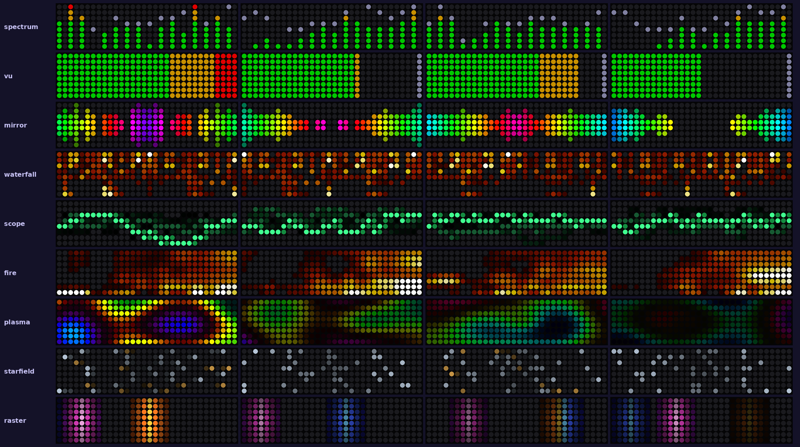
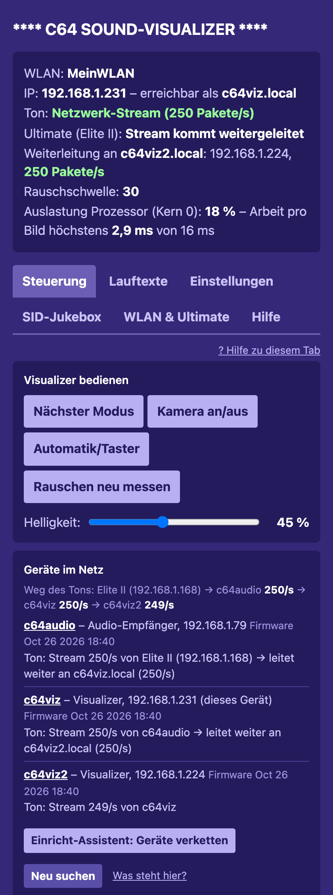
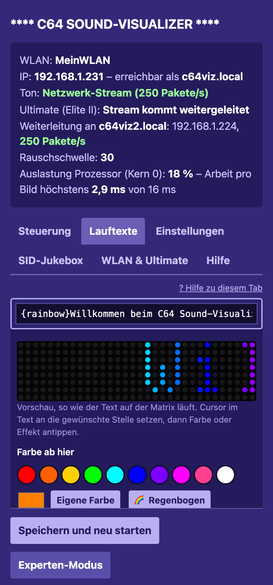
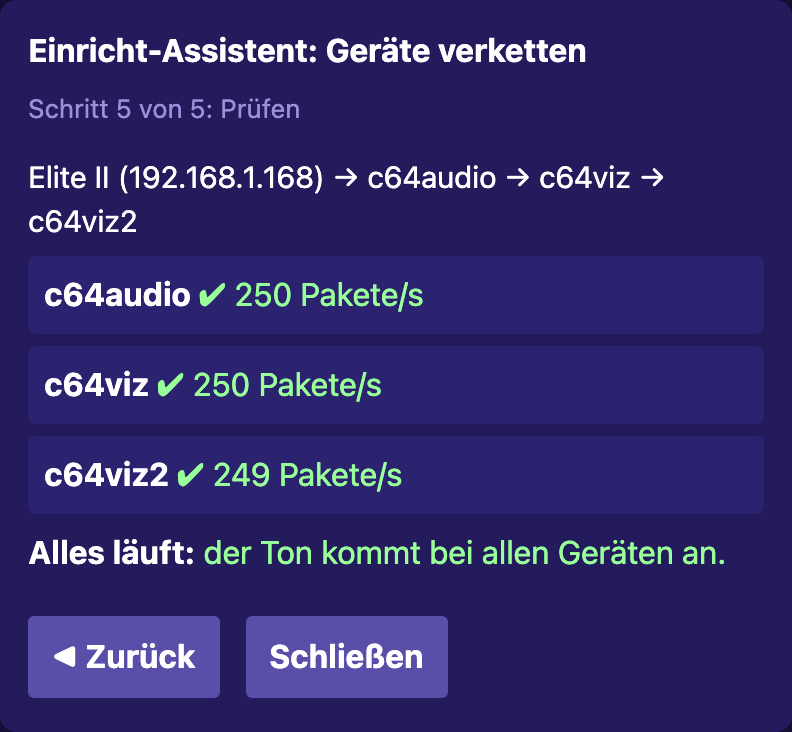
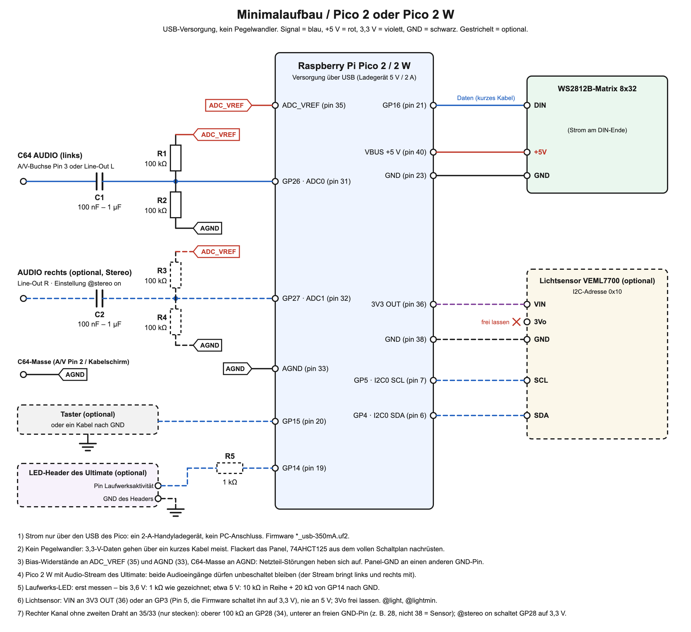
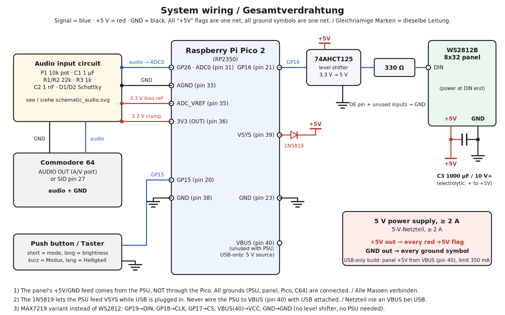
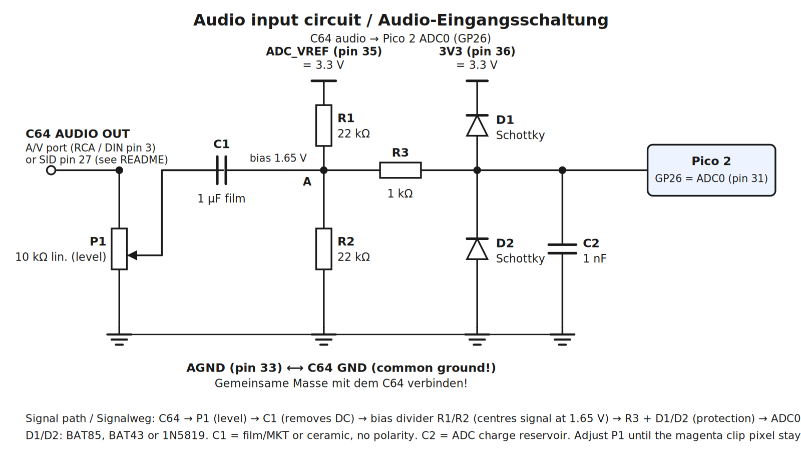

# C64 Sound-Visualizer – Pico 2 + WS2812B 8x32 RGB-Matrix

*English version: [README.md](README.md)*

**Bedienungsanleitung:** [docs/HANDBUCH.md](docs/HANDBUCH.md) – Bedienung, Weboberfläche, alle Einstellungen und Codes,
Fehlersuche. Dasselbe Handbuch steht im Tab **Hilfe** der Weboberfläche und des Offline-Editors.

Verwandelt den Sound eines Commodore 64 in eine Live-Lichtshow auf einer 8x32-RGB-LED-Matrix.
Läuft auf einem **Raspberry Pi Pico 2 (RP2350)**, geschrieben in C mit dem Pico SDK.

- **Siebzehn Visualizer-Modi**, alle aus derselben 512-Punkt-FFT (16 Bänder, 100 Hz – 6 kHz):
  `spectrum` (grün/gelb/rote Balken mit fallenden Spitzenpunkten), `vu` (Pegelanzeige), `mirror` (Bass in der Mitte,
  Regenbogen, nach oben und unten), `waterfall` (Spektrogramm, läuft nach links, Bass unten), `scope` (die Wellenform
  selbst mit Nachleuchten), `fire` (Flammen, gespeist von den Frequenzbändern), `plasma` (Demoszene-Plasma),
  `starfield` (Sterne fliegen nach außen), `raster` (C64-Rasterbalken)
- **Automatischer Wechsel oder per Taster**, eingestellt in `texts.txt`, umschaltbar durch 3 s Halten des Tasters
- **Ein Taster** – kurz = nächster Modus, 0,7–3 s halten = Helligkeit (7 / 20 / 45 / 100 %), 3 s halten = automatisch/Taster umschalten
- **Adaptive Pegel** – die Anzeige folgt Spitzen und Durchschnitt der Musik, leise Passagen bleiben unten, Spitzen
  erreichen oben, unabhängig von der Lautstärke
- **Flüssige 62 fps** – das Audio wird per DMA lückenlos aufgenommen, jedes Analysefenster überlappt das vorige zur Hälfte,
  und die LEDs werden per DMA im Hintergrund angesteuert
- **Gammakorrigierte LEDs mit Dithering** – Übergänge und dunkle Pixel (Feuer, Wasserfall, Nachleuchten) sehen aus wie auf
  einem Bildschirm, ohne grobe Helligkeitsstufen oder Farbverschiebungen
- **Automatische Pegelanpassung**, Rausch-Gate, Übersteuerungswarnung (magentafarbener Pixel oben rechts)
- **Leerlauf-Texte** mit Steuercodes (Blinken, Glühen, Explosion, Farbe, Regenbogen, Pause) aus einer Textdatei, wenn kein Ton anliegt
- Baut auch für **MAX7219**-8x8-Module (einzelnes 8x8 oder 4-in-1 8x32) – siehe [Display-Varianten](#display-varianten)

## Bilder

<p></p>
<p>



</p>

*Oben: einige der 17 Modi auf der Matrix. Unten: die Weboberfläche des Pico 2 W – Steuerung mit „Geräte im Netz“,
Lauftexte mit Vorschau, der Einricht-Assistent zum Verketten mehrerer Geräte.*

> **Anleitung für alle drei Geräte zusammen** (Visualizer, Audio-Empfänger, Raspberry-Pi-Jukebox – Einrichtung,
> Verkettung, Bedienung, Besonderheiten, mit Bildern): [docs/Anleitung_C64-Oekosystem.pdf](docs/Anleitung_C64-Oekosystem.pdf) –
> englisch: [docs/Guide_C64-Ecosystem.pdf](docs/Guide_C64-Ecosystem.pdf)

## Was geprüft wurde – und was nicht

| Geprüft | Nicht geprüft |
|---|---|
| Alle Firmware-Varianten bauen für `rp2350-arm-s` (Pico SDK 2.1.1); Host-Tests der Firmware (`tests/run_host_tests.sh`) und Browsertests der Weboberfläche (`tests/web/`) laufen am PC | **Getestet nur beim Autor:** Pico 2 W mit WS2812B 8x32 im eigenen Heimnetz, Audio vom Ultimate 64 Elite II (analog und als Netzwerk-Stream). Andere Router, WLANs und Ultimate-Firmwares können sich anders verhalten (z. B. Multicast, siehe [WLAN-Firmware](#wlan-firmware-pico-2-w)) |
| Signalverarbeitung am PC mit synthetischen Tönen und Rauschen getestet (Töne landen im richtigen Band, Stille bleibt dunkel) | Die Ausrichtung der Matrix ist geschätzt → Startanimation + Flags in `config.h` nutzen (siehe [Kalibrierung](#kalibrierung)) |
| LED-Zuordnung (spaltenweise, Serpentine) geprüft | Der genaue Pegel *deines* C64 → mit dem Poti P1 einstellen |

## Minimalaufbau (empfohlen für den Anfang)



Drei passive Bauteile und USB-Strom, dieselbe Firmware. Kompromisse: weniger maximale Helligkeit (USB), kein Pegelwandler
(3,3-V-Daten funktionieren über ein kurzes Kabel meist), keine Schutzbauteile (für das A/V-Port-Signal in Ordnung, nicht für den rohen SID-Pin-Abgriff).

| Anz. | Bauteil |
|---|---|
| 1 | Raspberry Pi Pico 2 oder Pico 2 W (mit Stiftleisten) |
| 1 | WS2812B-Matrix 8x32 |
| 1 | Kondensator 100 nF – 1 µF, Keramik oder Folie (C1) |
| 2 | 100-kΩ-Widerstand (R1, R2) |
| 1 | Taster (oder ein Jumperkabel GP15 → GND) |
| 1 | USB-Handyladegerät 5 V / 2 A + Micro-USB-Kabel |
| – | Steckbrett, Jumperkabel |
| optional | Stereo: zweiter Kondensator (C2) + 2 × 100 kΩ (R3, R4) an GP27 |
| optional | Laufwerks-LED des Ultimate: 1 kΩ (R5) an GP14 |
| optional | Lichtsensor VEML7700 an I2C (GP4/GP5, 3V3) für automatische Helligkeit – Gehäuse in `case/` |

Mit dem Pico 2 W und dem Audio-Stream des Ultimate entfallen die Audiobauteile (C1, R1, R2 und der Stereo-Satz).
Die Zeichnung erzeugt `docs/make_schematic_minimal.py` (englische Fassung: `docs/schematic_minimal.png`).

Firmware: `c64viz_ws2812_usb-350mA.uf2`. Flackert das Panel, den 74AHCT125 + 330 Ω aus dem vollen Schaltplan nachrüsten;
für mehr Helligkeit auf die Netzteil-Variante unten wechseln.

## Laufwerksanzeige (Ultimate 64)

Während das Ultimate von seinem virtuellen Laufwerk lädt, leuchten oben links zwei rote Pixel – über jedem Modus, über
den Leerlauf-Texten und über Meldungen. Das Signal kommt vom **LED-Header** des Ultimate (dem Anschluss für die Gehäuse-LEDs).

```
Ultimate LED-Header: Pin Laufwerksaktivität ──[1 kΩ]── GP14 (Pico-Pin 19)
Ultimate LED-Header: GND-Pin ─────────────────────── GND  (Pico-Pin 18 oder ein beliebiger GND)
```

1. Im Ultimate-Menü einen LED-Ausgang auf Laufwerksaktivität stellen (Option **DrvAAct+DrvBAct** – „LED an, wenn
   Laufwerk A oder B aktiv ist"). Beim klassischen U64-Header ist Pin 1 = Power, Pin 2 = GND, Pin 3 = Laufwerksaktivität.
   Der Header des Elite II hat mehr Ausgänge; prüf, welchen Pin du belegt hast.
2. **Erst messen:** Multimeter zwischen diesem Pin und GND, während ein Programm lädt. Bis etwa 3,6 V → der 1-kΩ-Widerstand
   oben. Misst du etwa 5 V, stattdessen einen Spannungsteiler: 10 kΩ in Reihe und 20 kΩ von GP14 nach GND.
3. Deine Gehäuse-LED kann parallel angeschlossen bleiben (Y-Kabel) – der Pico-Eingang zieht praktisch keinen Strom.

Die Firmware tastet den Pin pro Bild etwa 30 µs lang ab und erkennt so auch per PWM angesteuerte LED-Ausgänge; nach
jedem Aufblitzen bleibt die Anzeige 150 ms an, damit kurze Zugriffe sichtbar bleiben. Nichts angeschlossen = keine Anzeige
(interner Pull-down). `@driveled off` in `texts.txt` blendet sie aus; Position, Breite, Farbe und Haltezeit stehen in
`src/config.h` (`DRIVE_LED_*`, `COL_DRIVE`).

## Lichtsensor: automatische Helligkeit (optional)

Mit einem **VEML7700**-Lichtsensor passt sich die Matrix dem Raum an. Bei Tageslicht gilt die per Taster bzw. auf der
Webseite eingestellte Helligkeit, im Dunkeln (unter 1 Lux) wird sie bis auf `@lightmin` Prozent abgesenkt (Standard 10),
dazwischen stufenlos – gleichmäßig in der *empfundenen* Helligkeit (logarithmisch über die Lux, dann mit Gamma 2,2 in
LED-Leistung umgerechnet). `@lightcurve` legt fest, ab wann die volle Helligkeit gilt:

| Raumlicht | schwach (ab 300 Lux voll) | **mittel** (ab 1000 Lux, Standard) | stark (ab 3000 Lux) |
|---|---|---|---|
| 1 Lux | 10 % | 10 % | 10 % |
| 10 Lux | 34 % | 29 % | 26 % |
| 100 Lux (Wohnzimmer mit Licht) | 75 % | 58 % | 49 % |
| 300 Lux | 100 % | 77 % | 63 % |
| 1000 Lux | 100 % | 100 % | 81 % |

Heller wird es innerhalb weniger Sekunden, dunkler langsamer, damit vorbeigehende Personen nichts flackern lassen.
Gilt für Pico 2 und Pico 2 W.

```
VEML7700 VIN ── 3V3 OUT (Pin 36)        nicht an 5 V
VEML7700 GND ── GND     (Pin 38)
VEML7700 SDA ── GP4     (Pin 6)
VEML7700 SCL ── GP5     (Pin 7)
VEML7700 3Vo    frei lassen
```

Ist Pin 36 schon belegt, geht VIN an **GP3 (Pin 5)**: Die Firmware schaltet GP3 immer auf 3,3 V, der Sensor braucht
unter 0,1 mA. Dann liegen alle vier Kabel am Stück auf der linken Stiftleiste:

```
VEML7700 VIN ── GP3     (Pin 5)         von der Firmware auf 3,3 V geschaltet
VEML7700 SDA ── GP4     (Pin 6)
VEML7700 SCL ── GP5     (Pin 7)
VEML7700 GND ── GND     (Pin 8)
```

- Ohne Sensor ändert sich nichts. Der Pico sucht alle 5 s nach ihm, er darf also auch später eingesteckt werden.
- Einstellungen (Tab „Einstellungen" bzw. `texts.txt`): `@light on|off` (Standard an), `@lightmin 1…100`,
  `@lightcurve weak|medium|strong` („Stärke der Anpassung").
- Der Sensor fängt auch Licht der Matrix selbst ein (am Test-Pico nachts 0 → 46 Lux binnen einer Sekunde). Deshalb
  zählt als Raumlicht der **kleinste Wert der letzten 20 Sekunden** – Lauftexte und Visualizer haben immer dunkle
  Momente. Lampe aus wirkt sofort, Lampe an nach höchstens 20 s. Die ersten 5 s nach dem Einschalten (Startanimation,
  Rauschmessung mit leuchtendem Panel) werden nicht gemessen. Trotzdem: den Sensor möglichst so setzen, dass er die
  Matrix nicht direkt sieht – die Gehäuse in `case/` lassen ihn nach oben schauen (`sensor_case.scad`) oder setzen ihn
  neben die Matrix, angebaut an die mittlere Klammer, mit Blick in dieselbe Richtung wie die LEDs (`sensor_clamp.scad`).
- Die Statusseite des Pico 2 W zeigt die gemessenen Lux und wie weit die Matrix gerade abgesenkt ist.
- Feineinstellung: Kurve in `src/light_calc.c` (`light_target`), `WS_LIGHT_FLOOR` in `src/config.h` (die Matrix wird nie ganz dunkel).

## Texteditor (Webseite und offline)

Die Webseite des Pico 2 W ist in Tabs gegliedert: Steuerung (Knöpfe), Lauftexte, Einstellungen, SID-Jukebox, WLAN & Ultimate, Hilfe. Der Offline-Editor zeigt Lauftexte, Einstellungen und Hilfe.

**Hilfe:** Der Tab enthält das ganze Handbuch ([docs/HANDBUCH.md](docs/HANDBUCH.md)) mit Inhaltsverzeichnis; „? Hilfe zu diesem Tab“
in jedem anderen Tab springt zum passenden Abschnitt. Der Pico 2 W hält es gzip-komprimiert im Flash (`GET /hilfe`, rund 15 KB)
und lädt es erst, wenn der Tab geöffnet wird; im Offline-Editor ist es eingebaut.


Die Texte müssen nicht mehr von Hand geschrieben werden. Der Editor zeigt jeden Lauftext als eine Zeile; tippst du eine
Zeile an, erscheint direkt darunter eine **Live-Vorschau** der Matrix und die Knöpfe: Farben (10 Farbtupfer, beliebige
Farbe, Regenbogen), Effekte für das nächste Wort (Blinken, Glühen), für das vorige Wort (Explosion, Anhalten,
Dunkelpause) und das Tempo. Cursor an die Stelle setzen, an der der Effekt beginnen soll, Knopf antippen – der passende
Code (z. B. `{blink:3}`) wird eingefügt und die Vorschau spielt ihn ab. Unter den Texten stehen alle Einstellungen als
einfache Felder (Modi als Häkchen, Wechsel, Sekunden, Scroller-Text, Logo-Wort, Kamera-Modus, Laufwerksanzeige).
Der „Experten-Modus" zeigt weiterhin die reine `texts.txt`.

- **Pico 2 W:** Der Editor ist die Webseite des Pico; „Speichern" schreibt die Texte und startet den Pico neu.
- **Pico 2 (und ohne WLAN):** `tools/text_editor.html` in einem beliebigen Browser am PC öffnen – ohne Internet, ohne
  Python. Optional deine `texts.txt` laden, bearbeiten, „texts.uf2 herunterladen" speichert `texts.uf2` (und `texts.txt`).
  `texts.uf2` wie gewohnt auf den Pico kopieren. Die Datei ist byte-genau dieselbe, die `make_texts_uf2.py` erzeugt.

Quelle der Seite ist `tools/web/index.html`; `python3 tools/make_web_page.py` erzeugt daraus `src/net/web_page.h` und
`tools/text_editor.html` (Zeichensatz und Modusliste werden aus den Firmware-Quellen übernommen), aus `docs/HANDBUCH.md`
die Hilfe (`src/net/help_page.h`).

## WLAN-Firmware (Pico 2 W)

`firmware/c64viz_wifi_ws2812_usb-350mA.uf2` (und `..._psu-1500mA.uf2`) ist der komplette Visualizer plus WLAN. Sie läuft
nur auf einem **Pico 2 W**; die Pins sind dieselben wie beim Pico 2, die Verdrahtung ändert sich nicht.

**Erster Start:** Ohne WLAN-Einstellungen öffnet der Pico seinen eigenen Zugangspunkt **C64-Visualizer** (Passwort
**commodore64**) und lässt `WLAN C64-Visualizer 192.168.4.1` durchlaufen. Mit dem Handy verbinden und **http://192.168.4.1** öffnen.
Im Heimnetz ist der Pico danach auch ohne IP-Adresse als **http://c64viz.local** erreichbar (mDNS).

**Mehrere Visualizer im Netz:** Im Tab „WLAN & Ultimate" jedem einen eigenen **Gerätenamen** geben (1–16 Zeichen,
a–z, 0–9, Bindestrich), z. B. `wohnzimmer` → **http://wohnzimmer.local**. Der Name gilt auch in der Geräteliste des
Routers (DHCP) und für den eigenen Zugangspunkt (`C64-Visualizer-wohnzimmer`). Beim Start fragt der Pico im Netz nach,
ob der Name frei ist; antwortet schon ein anderes Gerät, nimmt er selbst `<name>-2` (bis `-9`). Die Statusseite und die
Matrix („WLAN 192.168.1.224  c64viz-2.local") zeigen, unter welchem Namen er gerade erreichbar ist.

**Die Webseite** enthält:
- Knöpfe: nächster Modus, Kamera-Modus, Automatik/Taster, und einen **Helligkeitsregler in Prozent** (4–100 %; 100 % =
  die bisher hellste Stufe, die Stromgrenze gilt weiter). Der Wert gilt sofort und wird 2 s nach der letzten Änderung
  gespeichert; mit Lichtsensor steht darunter, wie weit er gerade abgesenkt wird,
- einen Editor für `texts.txt` – speichern, und der Pico startet mit den neuen Texten neu (kein Python, kein USB, kein BOOTSEL),
- WLAN-Name und -Passwort (nur 2,4 GHz), **bis zu vier Ultimates** (Name, IP-Adresse, Netzwerk-Passwort falls gesetzt) und
  „Audio-Stream vom Ultimate verwenden",
- eine **Sicherung** aller Einstellungen als eine Datei und das Wiedereinspielen (siehe unten).

**Mehrere Ultimates (Ultimate 64, Elite, C64 Ultimate …):** unter „WLAN & Ultimate" eintragen – oder „Netzwerk nach
Ultimates durchsuchen" drücken: Der Pico fragt jede Adresse seines Heimnetzes (`/v1/info`, etwa 30 s) und listet jedes
Gerät, dessen Produktname „Ultimate" enthält, je Gerät einmal (ein Ultimate mit Ethernet und WLAN antwortet unter zwei
Adressen – genommen wird die Ethernet-Adresse, weil die Ultimates den Audio-Stream nur über Ethernet senden; ein nur per
WLAN gefundenes Gerät wird markiert); „übernehmen" trägt es in den nächsten freien Platz ein. Geräte mit
Netzwerk-Passwort werden nicht gefunden (sie antworten ohne Passwort nicht) – die von Hand eintragen. Ab zwei Geräten
erscheint unter „Steuerung" die Auswahl „Quelle": Das bisherige Gerät wird gebeten, nicht mehr an den Pico zu streamen
(nur wenn es das wirklich tut), das neue sofort gefragt; die Wahl bleibt ohne Neustart gespeichert. Jukebox,
Songlängen per FTP und SID-Adressen nutzen immer die Quelle. Solange die Jukebox des Pico spielt (oder ein umgestellter
SID-Sockel noch zurückgestellt werden muss), wird der Wechsel abgelehnt – erst stoppen. Es zählt immer nur ein Stream:
Pakete eines zweiten Absenders werden ignoriert, bis der erste 0,5 s lang still ist.

**Sicherung:** „Sicherung herunterladen" (Tab „WLAN & Ultimate") speichert WLAN, Webseiten-Passwort, Gerätename, die
Ultimates, Weiterleitung, Jukebox-Einstellungen, Helligkeit/Taster und texts.txt als `c64viz-<name>-<datum>.json`.
„Sicherung einspielen" spielt sie zurück (auch auf einen anderen Pico): Der Pico prüft alles, bevor er etwas schreibt,
und startet danach neu. Die Songlängen-Datenbank ist nicht dabei – die aus ihren Dateien neu einlesen. **Die Datei
enthält Passwörter** (WLAN, Ultimates).

Nach dem Speichern der WLAN-Daten startet der Pico neu, verbindet sich mit deinem WLAN und lässt seine neue Adresse
durchlaufen, z. B. `WLAN 192.168.1.57`. Ist das Heim-WLAN nach 20 s nicht erreichbar, öffnet er wieder den Zugangspunkt – und versucht das Heim-WLAN alle
5 Minuten erneut (nicht, solange die Seite am Zugangspunkt in den letzten 5 Minuten benutzt wurde – das Einrichten dort
wird nie unterbrochen). Bricht die Verbindung im Heim-WLAN ab (Router neu gestartet), verbindet er sich nach 10 s neu,
ohne Zugangspunkt. Meldet sich der Router, vergibt aber keine Adresse (DHCP hängt, z. B. direkt nach einem
Firmware-Update), meldet sich der Pico nach 10 s ab und neu an – den Zugangspunkt öffnet er erst nach 3 solchen
Versuchen. Ein abgelehntes WLAN-Passwort öffnet den Zugangspunkt sofort.

**Passwort:** Im Heimnetz fragt die Seite nach einem Passwort (HTTP Digest, Benutzername beliebig; das Passwort selbst geht nie übers Netz). Ab Werk:
**commodore64** – der Status warnt, bis du unter „WLAN und Ultimate" ein eigenes vergibst (6–32 Zeichen). Im eigenen
WLAN des Pico ist kein Webseiten-Passwort nötig (dort schützt das WLAN-Passwort). Passwort vergessen:
`firmware/wlan_reset.uf2` auf den Pico kopieren (BOOTSEL bzw. Modustaster beim Einstecken) – sie löscht nur die
WLAN-, Ultimate- und Webseiten-Einstellungen, danach öffnet der Pico wieder seinen Zugangspunkt. Hinweis: Ohne HTTPS
sind die Seiteninhalte (Texte, Einstellungen) nicht verschlüsselt; geschützt ist das Passwort.

**Ton übers Netzwerk:** Ist die IP des Ultimate eingetragen, bittet der Pico das Ultimate, seinen Audio-Stream zu starten
(REST-API `PUT /v1/streams/audio:start?ip=<pico>:11001`, Ultimate-Firmware ab 3.11, besser ab 3.14d) und wiederholt das
alle 10 s, solange kein Ton ankommt (z. B. nachdem das Ultimate ausgeschaltet war). Der Stream kommt aus dem Audio-Mixer
des Ultimate – dasselbe Signal wie an HDMI und DIN-Buchse –, UltiSID und echte SIDs funktionieren also beide. Solange
Pakete ankommen, wird der analoge Eingang ignoriert; bleiben sie 0,25 s aus, übernimmt wieder der analoge Eingang.

**Mehrere Empfänger (Multicast):** Auf der Webseite „mehrere Geräte gleichzeitig (Multicast)" wählen. Der Pico liest
dann das in den „Data Streams"-Einstellungen des Ultimate eingetragene Audio-Ziel (REST `GET /v1/configs/Data%20Streams`);
ist es eine Multicast-Adresse (224.x–239.x), nimmt er diese, sonst 239.0.1.65. Er tritt der Gruppe bei und bittet das
Ultimate, an sie zu senden, sodass ein PC denselben Stream gleichzeitig empfangen kann (im PC-Programm dieselbe Gruppe,
Port 11001). Im Unicast-Modus („nur dieser Pico") geht der Stream nur an den Pico; ein PC-Programm, das einen eigenen
Unicast-Stream startet, nimmt ihn weg, und der Pico holt ihn sich innerhalb von 10 s zurück.

**Gleichmäßige Bilder trotz WLAN:** Die Pakete des Streams kommen über WLAN in Schüben. Der Pico hält deshalb etwa
40 ms Ton als Reserve und zeigt die Bilder nach seiner eigenen Uhr alle 16 ms; den winzigen Gangunterschied der Uhren von
Ultimate und Pico gleicht er aus. Die Statusseite zeigt, wie oft er trotzdem auf Pakete warten musste.

**Achtung – Multicast ist über WLAN bei vielen Routern sehr langsam** (auf echter Hardware gemessen): Die Stream-Pakete
stauen sich, der Ping steigt auf Sekunden, Webseite und Jukebox sind kaum noch erreichbar. Unicast läuft bei derselben
Paketrate völlig flüssig – deshalb ist Unicast die Voreinstellung, und die Webseite zeigt beim Umschalten auf Multicast
eine Warnung. Multicast nur wählen, wenn wirklich mehrere Geräte den Stream gleichzeitig empfangen sollen.
Ein Wächter in der Firmware erkennt die typischen langen Paketlücken im Multicast-Betrieb und warnt dann auf der
Statusseite und einmal alle 10 Minuten auf der Matrix.

**Zwei Visualizer gleichzeitig ohne Multicast (Weiterleitung):** Der Ultimate streamt nur an eine Adresse. Beim ersten
Pico unter „Stream weiterleiten an" den zweiten eintragen (IP oder Name, z. B. `c64viz-2.local`) und „nur dieser Pico
(Unicast)" lassen: Er bekommt den Stream und reicht jedes Paket unverändert weiter (nie zurück an den Absender). Beim
zweiten Pico den Stream einschalten und „von einem anderen Pico weitergeleitet" wählen: Er fragt den Ultimate nie selbst
nach dem Stream – sonst nähme er ihn dem ersten weg. Die Statusseite des ersten Pico zeigt Ziel und weitergeleitete
Pakete pro Sekunde. Gemessen mit zwei Pico 2 W (2026-10-14): beide 251–253 Pakete/s, Ping 2 ms, Webseite 12–60 ms –
derselbe Stream per Multicast brachte auf beiden nur die Hälfte der Pakete und Pings von 1–3 s. Die Weiterleitung kostet
den ersten Pico etwa 8 % Prozessorlast.

**Geräte im Netz:** Jeder Visualizer und Audio-Empfänger meldet sich alle 10 s per UDP-Broadcast (Port 11064) mit Name,
Firmware-Stand und Weg des Streams. Die Karte „Geräte im Netz" im Tab „Steuerung" zeigt alle Geräte und den Weg des Tons
(„Elite II → c64audio 250/s → c64viz 250/s → c64viz2 250/s") und warnt, wenn eine eingetragene Weiterleitung nicht läuft.
Titelmeldungen der PC-Jukebox reicht ein Visualizer zusammen mit dem Ton an den nächsten weiter (`C64NP1` auf Port 11001,
kein Passwort nötig).

**Einricht-Assistent** (Karte „Geräte im Netz" bzw. Tab „WLAN & Ultimate"): wählt Geräte, Ultimate und Reihenfolge der
Kette, berechnet die Einstellungen jedes Geräts und öffnet dessen Seite vorausgefüllt (`#setup=<json>`) – gespeichert wird
dort mit dem Passwort des jeweiligen Geräts; Haken und Endprüfung kommen aus den Gerätemeldungen.

**Zwei Matrizen als ein Bild** (Tab „Einstellungen", `@wide lead|follow`, `@widepartner`, `@wideside`; ab Werk aus): Ein
Pico rechnet ein 64 × 8-Bild, zeigt seine Hälfte und schickt die andere jedes Bild an den Partner (UDP 11065, 780 Byte,
62/s), der sie mit der Helligkeit des ersten zeigt. Antwortet der Partner nicht, zeigt jeder wieder sein eigenes Bild.
Alle 17 Modi und die Lauftexte zeichnen in der Breite, die gerade gilt (32 oder 64).

**Alle Picos aktualisieren:** `python3 tools/update_all.py` findet alle Geräte, zeigt ihren Stand und spielt jedem die
passende Datei auf (jedes Gerät meldet, welche es braucht; Passwörter auf Wunsch im Schlüsselbund des Mac).

**Hinweise:** Webseite und Stream funktionieren ohne Internet, nur im Heimnetz. Passwort und Einstellungen liegen im
Flash des Pico (Sektor vor den Taster-Einstellungen). Auf echter Hardware noch nicht getestet.


## Schlafmodus, Uhr und Nacht (Leerlauf)

`@sleep 30` schaltet die Matrix nach 30 Minuten Stille aus (0 = nie). `@sleepstyle breathe` lässt die ausgeschaltete Matrix sanft atmen statt dunkel zu werden, `@sleepstyle clock` zeigt die Uhrzeit, die langsam aus- und wieder einblendet (Pico 2 W; der Pico 2 atmet dann) – auch in den Nachtstunden. `@sleepcolor FF4000` legt die Farbe dafür fest (`auto` = blaues Atmen, türkise Uhr). Musik weckt sie immer, ein Tastendruck hält sie eine
Minute wach. **Nur Pico 2 W:** Die Uhrzeit kommt aus dem Internet (pool.ntp.org) und läuft zwischen den Leerlauf-Texten
(`@clock on`); `@night 23:00-07:00` hält die Matrix in diesen Stunden dunkel; `@timezone europe` (Standard, MEZ/MESZ mit
automatischer Sommerzeit), `utc` oder ein fester Versatz wie `+1`. Alles steht auch im Einstellungsformular des Texteditors.
**Retro-News (Pico 2 W):** Die Raspberry-Pi-Jukebox kann die Schlagzeilen ihrer Retro-News schicken (Schlagzeilen aus RSS-Feeds wie Indie Retro News, amiga-news.de, Commodore News …);
nach jedem Leerlauf-Text läuft eine in Gelb durch (`POST /news` oder `C64NEWS1` per UDP, wird in der Kette
weitergereicht, nach 3 h vergessen; `@news off` blendet sie aus).

## SID-Jukebox (Pico 2 W)

Auf der Webseite einzelne SID-Dateien oder einen ganzen Ordner (mit Unterordnern) wählen, optional in zufälliger
Reihenfolge. Der Pico schickt jede Datei ans Ultimate (`POST /v1/runners:sidplay`), die Matrix zeigt Titel und Komponist
aus dem SID-Kopf. Nächster Titel nach einstellbarer Zeit oder nach 5 s Stille; Unterlieder wählbar; Pause / Fortsetzen /
Stopp (Reset) steuern das Ultimate. Die Wiedergabeliste lebt in der geöffneten Webseite – zum Weiterspielen offen lassen.
Die Ordnerauswahl funktioniert in Desktop-Browsern, auf iPhones meist nur die Auswahl einzelner Dateien.

## USB-Stick am Ultimate (Pico 2 W)

Im Tab SID-Jukebox die Quelle per Radio-Button wählen („USB-Stick am Ultimate" oder „PC") und mit „Auswählen …" einen Ordner aussuchen – ein Dialog, der den Speicher des Ultimate per **FTP** durchsucht, bzw. der Ordnerdialog des PCs (einzelne Dateien: „Einzelne Dateien …"). Der Pico merkt sich Quelle und Ultimate-Ordner. Für das Ultimate liest er den Speicher per **FTP** (der FTP-Dienst des Ultimate muss eingeschaltet sein; ein
gesetztes Netzwerk-Passwort wird verwendet). Zu einem Ordner durchklicken und „Diesen Ordner abspielen" drücken (wahlweise
mit Unterordnern) oder eine einzelne SID anklicken. Der **Pico hält die Wiedergabeliste** (bis 256 Titel) und spielt sie
selbstständig ab – auch bei geschlossener Webseite: Er lädt jede Datei per FTP (für Songlänge und Titel) und bittet das
Ultimate, sie von seinem eigenen Speicher zu spielen (`PUT /v1/runners:sidplay?file=...`). Weiter / zurück / Stopp, Zufall,
Zeitlimit und „weiter nach 5 s Stille" wie bei der PC-Jukebox. Die Seite zeigt die Wiedergabeliste des Pico wie bei der
PC-Quelle an (laufender Titel hervorgehoben); ein Klick auf einen Titel spielt ihn direkt. Hat ein Titel mehrere
Unterlieder, erscheint eine Unterlied-Auswahl. Der Datei-Dialog hat ein Filterfeld für große Ordner, und während ein
Titel mit bekannter Länge spielt, zeigt die unterste Matrix-Zeile dezent den Fortschritt.

**Playlists aus dem Ultimate64 SID Player:** „Playlist (.json) …" lädt eine mit dessen Export-Funktion geteilte
Playlist-Datei (`…_u64playlist.json`). Die Titel werden – wie beim Import im SID Player selbst – per Dateiname im
gewählten Ordner (samt Unterordnern) gesucht; die Reihenfolge der Playlist bleibt erhalten, nicht gefundene Titel
werden verworfen und gezählt („12 von 64 Titeln gefunden"). Bis zu 320 Titel pro Playlist.

**SID-Adressen automatisch umstellen** (Schalter im Jukebox-Tab, Standard aus): Braucht ein Stück einen SID an einer
Adresse, die kein Sockel hat (Kopf ab PSID v3, z. B. $D420 oder $D500 für den zweiten SID), stellt der Pico den einen
freien Sockel für dieses Stück um – nur die echten SIDs in den Sockeln, nie die UltiSIDs, und nur im eindeutigen Fall
(genau eine Adresse fehlt, genau ein Sockel wird nicht gebraucht). Zurückgestellt wird beim Stopp, beim nächsten Stück
ohne diesen Bedarf, nach 60 s Stille und nach einem Neustart des Pico – die ursprüngliche Adresse merkt er sich dafür
im Flash. Die Änderung wird im Ultimate nicht dauerhaft gespeichert. Gilt für beide Quellen (Stick und PC).

**SID-Adressen auf der Matrix anzeigen** (Schalter im Jukebox-Tab): Die Belegung der Sockel läuft über die Matrix
(z. B. „SID 1: D400  SID 2: D500") – beim Einschalten, sobald der Ultimate erreichbar ist, wenn sie sich ändert (der
Pico prüft jede Minute, also auch nach Änderungen durch andere Programme) und zusammen mit dem Titel, wenn ein Stück
eine andere Belegung braucht. Der Jukebox-Tab zeigt die aktuelle Belegung immer an. Sehr große Ordner kann der Dialog nicht vollständig
anzeigen (ca. 720 Einträge bzw. 56 KB FTP-Liste; alle HVSC-Buchstabenordner von DEMOS, GAMES und MUSICIANS passen); dann erscheint der Hinweis „Liste gekürzt".
Beim Abspielen oder Playlist-Suchen mit Unterordnern merkt sich der Pico bis zu 48 noch zu lesende Unterordner; bei
sehr tiefen Bäumen (z. B. die ganze HVSC als Startordner) wird übersprungen, was darüber hinausgeht – die Seite meldet
dann ehrlich „nicht alles durchsucht".

**Songlängen:** Mit einer Songlängen-Datenbank wechselt die Jukebox genau am Ende eines Titels. Quellen: die HVSC-Datei
`Songlengths.md5` (`<md5>=m:ss m:ss ...`, eine Zeit pro Unterlied) und die eigene Datei des Ultimate64 SID Player /
SID-Jukebox (`<md5>=<Sekunden>`); eigene Einträge haben Vorrang. Quelle per Radio-Button wählen („USB-Stick am Ultimate" oder „PC"), jede Datei mit „Auswählen …" aussuchen – ein
Dateidialog, der den Speicher des Ultimate durchsucht, bzw. der normale Dateidialog des PCs – und „Songlängen einlesen"
drücken. Der Pico merkt sich die Quelle und die Pfade auf dem Stick. Ist die Länge eines Titels unbekannt, zeigt die Seite
seine MD5, damit man sie in den Dateien nachsehen kann. Der Pico speichert die
Datenbank im Flash (1 MB – 3 MB, Platz für weit mehr als die ganze HVSC) und berechnet die MD5 jeder SID zum Nachschlagen –
für Stick-Titel und für vom PC hochgeladene Dateien. Unbekannte Titel nutzen das Zeitlimit. Beim Start eines Titels zeigt die Matrix Titel und Komponist – und, wenn der Titel in einer der Songlängen-Dateien steht, seine Spielzeit (z. B. `4:36`).
„Datenbank löschen" entfernt nach einer Sicherheitsabfrage alle gespeicherten Songlängen wieder aus dem Pico.

## Ultimate64 SID Jukebox am PC (Pico 2 W)

Spielt die **Ultimate64 SID Jukebox** (Python-Programm am PC, ab Version 1.82) die SIDs, meldet sie dem Pico jeden Titel.
Dort unter *Settings → Preferences… → C64 Visualizer* einschalten, Adresse (`c64viz.local` oder die IP) und das
Web-Passwort des Pico eintragen, „Test Connection" prüft die Verbindung. Der Pico

- zeigt Titel, Komponist und Länge auf der Matrix (bei „SID-Adressen auf der Matrix anzeigen" zusammen mit einer vom PC
  umgestellten Sockelbelegung, nach dem Stopp die zurückgestellte),
- lässt den Fortschrittspunkt laufen und schaltet nach dem SID-Kopf zwischen Mono und Stereo (wie bei der eigenen Jukebox),
- zeigt den Titel im Jukebox-Tab („Jukebox am PC spielt: …"),
- beendet eine eigene laufende Wiedergabe (ohne Reset – der Ultimate spielt ja das Stück vom PC).

**Audio-Stream:** Der Ultimate schickt seinen Stream nur an *einen* Empfänger. Nutzt das Programm ihn selbst (Spectrum
Analyzer, „Play Audio Locally", „Skip after silence"), reicht es jedes Paket an den Pico weiter (Schalter „Forward the
audio stream", nur Unicast) – am Gerät gemessen bekam der Pico dabei weiter ~250 Pakete/s. Gibt das Programm den Stream
frei, holt der Pico ihn sich nach wenigen Sekunden selbst zurück.

**Schnittstelle** (für eigene Programme; Digest-Login mit dem Web-Passwort, Benutzername beliebig):

| Anfrage | Bedeutung |
|---|---|
| `POST /jb/np?new=1&title=…&author=…&secs=117&el=0&song=1&songs=3&sid=D400,D420` | neuer Titel; `secs` 0 = Länge unbekannt, `sid` die Adressen aus dem SID-Kopf (oder `chips=n`) |
| `POST /jb/np?title=…&secs=117&el=60…` (ohne `new`) | Uhr abgleichen, z. B. alle 30 s – keine neue Titelmeldung |
| `POST /jb/np?stop=1` | Wiedergabe beendet |
| `GET /jb/np` | aktueller Stand als JSON (auch in `/jb/state` unter `np`) |

Antwort 409 heißt „vorige Meldung noch nicht übernommen" – kurz warten und wiederholen. Kommt nichts mehr (Programm
abgestürzt), endet die Anzeige 5 s nach dem Ende des Titels bzw. nach 75 s ohne Nachricht bei unbekannter Länge.

## Simulator

`tools/simulator.html` führt den **echten Firmware-Code** (Analyse, alle 17 Modi, Demo-Tune) im Browser aus – als
WebAssembly, mit einer reinen JavaScript-Fassung als Rückfall (beide pixelgleich zur Firmware). Tonquellen: eingebauter
Demo-Tune (hörbar), eine Audiodatei (auch per Ziehen auf die Matrix) oder das Mikrofon. `python3 tools/make_simulator.py`
baut ihn neu (braucht clang/wasm-ld und wasm2js aus binaryen).

## Demo-Firmware (ohne Audio)

`firmware/demo_*.uf2` braucht weder C64 noch Audioeingang: Ein kleiner Chiptune im SID-Stil (Arpeggios, Bass, Lead,
Schlagzeug) wird auf dem Pico selbst erzeugt. In einer Endlosschleife laufen:

1. alle Texte aus deiner `texts.uf2` (oder zwei eingebaute Demotexte, wenn keine geflasht ist),
2. jeder Visualizer-Modus für **5 Sekunden**, in der Reihenfolge von `@modes`, jeweils mit seinem Namen angekündigt.

Taster (optional): kurz drücken = zum nächsten Punkt springen, 0,7 s halten = Helligkeit. Praktisch zum Testen eines
frisch gebauten Panels, zum Vorführen oder für ein Video. Für den echten Visualizer wieder die normale `c64viz_*.uf2`
flashen. Optionen: `DEMO_MODE_S` (Sekunden pro Modus), `DEMO_SHOW_NAMES` (0 = ohne Namen), in `src/demo_main.c`.

## Modi und Wechsel

| Name in `@modes` | Was du siehst |
|---|---|
| `spectrum` | 16 Balken, grün/gelb/rot, fallende Spitzenpunkte |
| `vu` | horizontale Pegelanzeige mit Spitzenmarke |
| `mirror` | Bass in der Mitte, höhere Bänder zu beiden Rändern, wächst nach oben und unten, langsam wandernder Regenbogen |
| `waterfall` | Spektrogramm: die Zeit läuft nach links, Bass unten, die lauten Anteile leuchten blau, cyan und weiß |
| `scope` | Oszilloskop: die Wellenform selbst, getriggert, mit Nachleuchten |
| `fire` | Flammen: jede Spalte wird von ihrem Frequenzband gespeist |
| `pulse` | jeder Beat schickt eine Druckwelle von der Mitte zu den Rändern, dazwischen ruhiges Glimmen in der Farbe der Mitten |
| `fountain` | jedes Band schießt Funken nach oben, die mit Schwerkraft zurückfallen; laute Stellen sprühen bis oben |
| `plasma` | Demoszene-Plasma: bewegt sich schneller, wenn es laut ist, Farben wandern mit dem Bass, blitzt bei Beats |
| `starfield` | Sterne fliegen aus der Mitte nach außen, schneller bei Lautstärke, warme Funken bei Beats |
| `raster` | C64-Rasterbalken: ein Bass-, ein Mitten- und ein Höhenbalken schwingen über das Panel, Helligkeit = Pegel |
| `scroller` | Demoszene-Sinus-Scroller mit dem Text aus `@scroller`: Wellenhöhe = Bass, fließende Farben, Blitz bei Beats |
| `loader` | C64-Ladestreifen in der C64-Palette: breit und ruhig bei leisen Stellen („Pilotton"), schmal und schnell bei lauten; Farben wechseln bei Beats |
| `logo` | das Wort aus `@logo` (Standard „C64") füllt sich wie Equalizer-Balken, der Umriss bleibt schwach sichtbar |
| `melody` | der lauteste Ton als laufende Linie, jeder Notenname hat seine Farbe |
| `rain` | digitaler Regen: lautere Bänder lassen mehr und schnellere Tropfen fallen |
| `life` | Conways Game of Life, bei jedem Beat werden neue Zellen gesät, Farben aus den Frequenzbändern |

**Taster:** kurz drücken = nächster Modus – vorher läuft sein Name durch (während des Namens erneut drücken springt weiter; `@names always` zeigt Namen auch beim automatischen Wechsel, `@names off` nie). 0,7–3 s halten und loslassen = nächste Helligkeit (7 → 20 → 45 → 100 %; von einem Wert des Webreglers aus die nächsthöhere). **3 s halten** =
umschalten zwischen *automatischem* Wechsel (die Matrix zeigt **automatic**) und Wechsel *nur per Taster* (die Matrix
zeigt **Button**). Ein Tastendruck beendet außerdem die Leerlauf-Texte.

**Einstellungen in `texts.txt`:**

```
@cycle 20                  Sekunden pro Modus beim automatischen Wechsel (zählt nur, solange Musik läuft)
@switching auto            startet mit automatischem Wechsel; "button" = nur per Taster
@modes spectrum, scroller, mirror, plasma, loader, waterfall, logo, fire, raster, melody, scope, rain, starfield, life, pulse, fountain, vu
                           welche Modi in welcher Reihenfolge (Standard: alle siebzehn)
```

Die 3-Sekunden-Umschaltung und die Helligkeit werden **im Flash gespeichert** (letzter 4-KB-Sektor) und überstehen
einen Neustart. Flashst du eine *geänderte* `texts.uf2`, gelten wieder deren `@switching` und `@brightness`. Ein Speichern
schreibt eine 256-Byte-Flash-Seite; gelöscht wird der Sektor nur bei jedem 16. Speichern, Verschleiß spielt also keine Rolle.


**Kamera-Modus (Doppelklick):** zum Filmen der Matrix. Er schaltet das zeitliche Dithering ab, das auf Handy- und
Kameravideos als Flimmern oder Streifen erscheinen kann. Ein Doppelklick schaltet um; die Matrix zeigt **Cam an** (grün)
oder **Cam aus** (rot). Der Zustand wird gespeichert und **bei jedem Start angezeigt**. `@camera on` in `texts.txt`
legt die Voreinstellung fest.

**Automatischer Wechsel im Takt:** Ist `@cycle` abgelaufen, startet der nächste Modus auf dem nächsten Beat (höchstens
3 s später) und wird über etwa 0,3 s eingeblendet statt hart umzuschalten.

**Automatische Rauschschwelle:** `@threshold` steht jetzt standardmäßig auf `auto`: In der ersten Sekunde nach dem
Einschalten (während der Kamera-Status angezeigt wird) misst der Pico das Eingangsrauschen und legt die Schwelle knapp
darüber. In Stille einschalten; läuft schon Musik, gilt der alte Standardwert 25. `@threshold 25` (eine Zahl) schaltet
die Automatik ab.


**Stille-Sperre:** Solange 0,3 s lang kein Ton über der Schwelle ankommt, zeigen alle Modi Stille. Ohne sie würde die
automatische Pegelanpassung selbst kleines Rauschen auf volle Größe aufblasen. Beim Einschalten leuchtet das Panel 1,5 s lang
(`CAL_MS` in `src/config.h`) zur Hälfte, während der Pico das Rauschen **bei eingeschalteten LEDs** misst (LED-Strom kann in den
Eingang einkoppeln).

**Wenn die Anzeige ohne Musik ausschlägt:** R1 an **ADC_VREF (Pin 35)** und R2 sowie die C64-Masse an **AGND (Pin 33)**
anschließen (siehe Minimal-Schaltplan); die Masse der Matrix an einen anderen GND-Pin. So wirken Schwankungen der
Versorgung auf Signal und ADC-Referenz gleich und heben sich auf. Notfalls eine feste Schwelle setzen, z. B. `@threshold 60`.


**Rauschen neu messen (Dreifachdruck):** Musik anhalten, Taster dreimal schnell drücken. Die Matrix zeigt „Ruhe bitte",
misst 1,5 s lang (Panel zur Hälfte an) und zeigt die neue Schwelle, z. B. „Schwelle 34". Beim Pico 2 W auch über die
Webseite („Rauschen neu messen"); der Status dort zeigt die aktuelle Schwelle.

**Stör-Spitzen:** Ton muss mindestens 0,16 s anhalten, um zu zählen; kurze Spitzen starten weder den Visualizer noch
beenden sie die Leerlauf-Texte. Folgt auf einen kurzen „Ton" (unter 1,5 s), der nur knapp über der Schwelle lag, wieder
Stille, wertet die Firmware ihn als Störung und hebt die Schwelle knapp darüber an (höchstens 120). Mit einer festen
`@threshold` ändert sich die Schwelle nie von selbst.

**Watchdog:** Sollte die Firmware je länger als 2 s hängen, startet der Pico von selbst neu.

## Leerlauf-Texte (Textdatei mit Steuercodes)

Wenn eine Weile kein Ton anliegt (`@silence`, Standard 8 s), wechselt der Visualizer zu Lauftexten, Zeile für Zeile; sobald
der C64 wieder Ton ausgibt, übernimmt sofort der Visualizer. Ohne eigene Textdatei wird ein eingebauter Demotext gezeigt.

**Eigene Texte:** `texts.txt` bearbeiten (die Datei erklärt jeden Code), dann umwandeln und flashen:

```bash
python3 tools/make_texts_uf2.py texts.txt          # erzeugt texts.uf2
```

BOOTSEL gedrückt halten, Pico 2 anstecken, `texts.uf2` auf das Laufwerk kopieren – genau wie die Firmware. Die Firmware bleibt
unangetastet; die Texte liegen bei Flash-Offset 0x300000, beides lässt sich also unabhängig aktualisieren.
(`firmware/texts_example.uf2` ist die umgewandelte `texts.txt`.) Sollte das Laufwerk die Datei ablehnen, das Skript mit
`--family arm` aufrufen; alternativ erzeugt `picotool uf2 convert texts.bin texts.uf2 --family data --offset 0x10300000` dasselbe.

**Format:** `#`-Kommentare und Leerzeilen werden ignoriert, `@silence`, `@speed`, `@brightness`, `@threshold`, `@cycle`, `@switching`, `@modes`, `@driveled`, `@names`, `@scroller`, `@logo`, `@camera`, `@stereo`, `@light`, `@lightmin`, `@lightcurve` sind Einstellungen,
jede andere Zeile ist ein Text. Codes: `{color:red}` / `{color:FF8000}`, `{rainbow}`, `{blink}` / `{blink:5}`, `{glow}` / `{glow:5000}`,
`{explode}`, `{hold:2000}`, `{pause:800}`, `{speed:40}`. Neu: `{typewriter}` (das nächste Wort wird Buchstabe für Buchstabe getippt), `{wave}` / `{wave:0}` (Buchstaben schwingen), `{sparkle}` / `{sparkle:0}` (weißes Funkeln), `{cursor}` (blinkender C64-Cursorblock hinter dem vorigen Wort, z. B. `{typewriter}READY{cursor}{hold:3000}`). `blink` und `glow` wirken auf das *nächste* Wort, `explode` und `hold` auf
das *vorherige*; jeder dieser Codes hält das Wort mittig auf dem Panel an. Beispiel:

```
{rainbow}{blink:3}C64{explode}{pause:500}{color:orange}Sound {glow:3500}Visualizer
```

Grenzen: 32 Texte, etwa 100 Zeichen pro Text, 64 KB gesamt. Der Zeichensatz umfasst A–Z, a–z, 0–9, Leerzeichen, `! . -`;
andere Zeichen erscheinen als Kästchen.

## Matrix-Test (ohne Audio)

`firmware/matrix_test_*.uf2` ist eine kleine Demo: **„READY"** scrollt mit wanderndem Regenbogen herein und bleibt mittig stehen, hält, blinkt dreimal, **explodiert** dann (weißer Blitz, Feuerball, jeder Pixel plus zusätzliche Funken fliegen nach außen), **„C64 Sound Visualizer"** läuft durch und **„SID"** bleibt mittig stehen und **glüht** wie heißes Metall (atmender weiß-gelber Kern, oranger Halo, Flackern), bevor es ausblendet. Dann von vorn. Zuerst flashen, um
Stromversorgung, Datenleitung und Ausrichtung zu prüfen. Läuft der Text falsch herum, gespiegelt oder durcheinander, die `WS_*`-Flags
in `src/config.h` anpassen (siehe Kalibrierung). Texte, Halte-/Blink-/Explosions-/Glühzeiten, Geschwindigkeit und Farben sind `#define`s am Anfang von `src/matrix_test.c`;
der Zeichensatz umfasst A–Z, a–z, 0–9 (a/n/t/u sind schmal; ein Wort, das mittig stehen bleibt, muss in 32 Spalten passen).

## Stückliste (Vollausbau)

| Anz. | Bauteil | Hinweis |
|---|---|---|
| 1 | **Raspberry Pi Pico 2** (RP2350) | Am besten „Pico 2 H" mit vorgelöteten Stiftleisten |
| 1 | **WS2812B flexible LED-Matrix 8x32 (256 Pixel)** | z. B. [AZDelivery bei Amazon.de](https://www.amazon.de/AZDelivery-anpassbar-Individuell-adressierbar-Unterst%C3%BCtzung/dp/B09Z6P39KD) – in der Variantenauswahl **8x32** wählen (bei meiner Prüfung ca. 12 €; Preise ändern sich) |
| 1 | **5-V-Netzteil, ≥ 2 A** + DC-Buchse mit Schraubklemmen | Empfohlen. Nur-USB geht mit geringer Helligkeit (siehe [Stromversorgung](#stromversorgung)) |
| 1 | 74AHCT125 (DIP-14) | Pegelwandler 3,3 V → 5 V. Optional, aber empfohlen |
| 1 | 100 nF Keramik | Abblockung am 74AHCT125 |
| 1 | 330-Ω-Widerstand | Serienwiderstand in der Datenleitung, nah am Panel |
| 1 | 1000 µF Elko, ≥ 10 V | C3, über +5 V/GND am Panel |
| 1 | 10-kΩ-Potentiometer (linear) oder Trimmer | P1, Audiopegel |
| 1 | 1 µF Folienkondensator (MKT) oder Keramik | C1, Wechselspannungskopplung, **ohne Polung** |
| 2 | 22-kΩ-Widerstand | R1, R2 Bias-Teiler (1,65 V) |
| 1 | 1-kΩ-Widerstand | R3 |
| 1 | 1 nF Keramikkondensator | C2 |
| 2 | Schottky-Diode BAT85 (oder BAT43) | D1, D2 Eingangsschutz |
| 1 | Schottky-Diode 1N5819 | Speist Pico-VSYS aus dem Netzteil |
| 1 | Taster | Modus / Helligkeit |
| 1 | Audiokabel vom C64 | 5-/8-poliger DIN-Stecker (oder Cinch, je nach Gerät/Kabel), siehe [Audioquelle](#audioquelle) |
| – | Steckbrett oder Lochraster, Jumperkabel | |
| optional | 28-poliger DIP-Testclip | Nur für den SID-Pin-Abgriff |

## Verdrahtung





(Vektorversionen: `docs/wiring.svg`, `docs/schematic_audio.svg`.)

**Anschlüsse am Pico 2**

| Pico-2-Pin | Geht an |
|---|---|
| GP26 (Pin 31) | Ausgang der Audioschaltung (nach R3) |
| AGND (Pin 33) | Masse der Audioschaltung und C64-GND |
| ADC_VREF (Pin 35) | Oberes Ende von R1 (3,3-V-Bias-Referenz) |
| 3V3 OUT (Pin 36) | Kathode von D1 |
| GP15 (Pin 20) | Taster, andere Seite an GND |
| GP16 (Pin 21) | 74AHCT125 Pin 2 (1A) |
| VSYS (Pin 39) | Kathode der 1N5819, Anode an +5 V des Netzteils |
| GND (z. B. Pin 23, 38) | Gemeinsame Masse |

**74AHCT125 (DIP-14):** Pin 14 = +5 V (100 nF nach GND), Pin 7 = GND, Pin 2 = 1A ← GP16, Pin 3 = 1Y → 330 Ω → Panel-**DIN**,
Pin 1 (OE̅) = GND. Eingänge der ungenutzten Gatter (5, 9, 12) und deren OE̅-Pins (4, 10, 13) an GND, Ausgänge offen lassen.

**Panel:** +5 V / GND des Netzteils an das 2-polige Stromkabel des Panels, C3 parallel dazu. Das Panel am **DIN**-Ende einspeisen
(die Pfeile auf der Platine zeigen vom DIN weg). Panel-GND, Netzteil-GND, Pico-GND und C64-GND sind alle verbunden.

### Stromversorgung

| Option | Wie | Firmware |
|---|---|---|
| **A – Netzteil (empfohlen)** | 5-V/2-A-Netzteil speist das Panel und über die 1N5819 den Pico-VSYS. USB darf steckenbleiben | `c64viz_ws2812_psu-1500mA.uf2` |
| **B – Nur USB** | Panel-+5-V von VBUS (Pin 40). Funktioniert, aber USB erlaubt nur etwa 500 mA insgesamt | `c64viz_ws2812_usb-350mA.uf2` |

> Das Netzteil niemals an VBUS (Pin 40) anschließen, solange USB steckt. Ein voll weißes 8x32-Panel könnte über 10 A ziehen – die
> Firmware schätzt deshalb in jedem Frame den Strom und dimmt automatisch auf das Limit (`POWER_LIMIT_MA`).

### Audioquelle

Der einfachste und sicherste Abgriff ist der **A/V-Port** des C64: **Pin 3 = AUDIO OUT, Pin 2 = GND** (bei der 5- und der 8-poligen DIN-Buchse).

> **Vorsicht:** An der 8-poligen Buchse des C64C führt **Pin 8 +5 V**; bei frühen 5-poligen Geräten führt Pin 1 6 V für den HF-Modulator.
> Diese niemals an Pico oder Masse anschließen. Nur Pin 2 und 3.

Ultimate-64-artige Nachbauten mit Line-Out-Buchse können stattdessen deren Line-Out nutzen.

**Alternative: AUDIO OUT des SID (Pin 27) abgreifen** – nur für Erfahrene. Der Pegel beträgt bis ca. 3 Vss auf etwa 6 V Gleichspannung
(Datenblatt), die Platine liefert bereits den passenden Pull-down (1 kΩ bei 6581-Boards, keiner bei 8580-Boards), C1 entfernt den Gleichanteil.
Einen DIP-28-Testclip auf einem gesockelten SID verwenden; nicht an die Chip-Beinchen löten. P1 weiter zurückdrehen, weil der Rohpegel höher ist als an der Buchse.

### Stereo (optional)

Für echtes Stereo (z. B. Ultimate 64 mit zwei SIDs, Line-Out links/rechts) bekommt der rechte Kanal einen zweiten Eingang an
**GP27 (Pin 32)** – mit einem **zweiten Satz derselben Eingangsschaltung wie an GP26**. Minimalaufbau: Kondensator
100 nF–1 µF in Reihe zu GP27, ein 100-kΩ-Widerstand von GP27 an ADC_VREF (Pin 35), einer von GP27 an AGND (Pin 33).
Voller Aufbau: zusätzlich ein zweites Poti, 1 kΩ, 1 nF und zwei Schutzdioden wie beim linken Kanal. Die Masse des
Stereo-Kabels kommt wie gehabt an AGND. In den Einstellungen „Stereo" einschalten (`@stereo on`).

**Ohne zweiten Draht an ADC_VREF/AGND (nur stecken, nichts am Pico löten):** Sind Pin 35 und Pin 33 schon mit dem linken
Kanal belegt, kommt der obere 100-kΩ-Widerstand des rechten Kanals an **GP28 (Pin 34)** statt an ADC_VREF und der untere
an einen freien **GND-Pin** (z. B. Pin 28 – Pin 38 hat der Lichtsensor) statt an AGND. Die Firmware schaltet GP28 bei `@stereo on` dauerhaft auf
3,3 V (sonst hochohmig) – so bleibt auch 3V3 (Pin 36) frei für den Lichtsensor. Die Widerstände an Dupont-Kabel löten
oder auf ein Mini-Steckbrett setzen. Der rechte Kanal hängt damit an der normalen 3,3-V-Versorgung statt am gefilterten
ADC_VREF – minimal mehr Grundrauschen, das die Rauschmessung beim Start ausgleicht.
Beim Pico 2 W mit Audio-Stream braucht es keine Verdrahtung: Der Ultimate sendet links und rechts ohnehin getrennt.

Der Pico **prüft selbst**, ob am zweiten Kanal wirklich ein eigenes Signal ankommt (jeweils über etwa 2 s Musik):
- **rechts kein Signal** (nichts angeschlossen) → Mono vom linken Eingang,
- **rechts = links** (Mono-Quelle auf beiden Kanälen, oder Übersprechen eines offenen Eingangs) → Mono,
- **zwei verschiedene Signale** → Stereo.

Das Ergebnis läuft einmal über die Matrix („Stereo", „Mono: rechts leer" …) und steht auf der Statusseite. Zurück zu
Mono schaltet er erst nach etwa 60 s durchgehend Mono: In Stereo-Stücken spielt oft längere Zeit nur ein SID, und weil
der Ultimate die SIDs nur teilweise links/rechts verteilt, sieht das wie Mono aus. Startet die Jukebox ein neues Stück,
entscheidet das erste Fenster sofort neu – ein Mono-Stück wird so nach etwa 2 s erkannt.

**Stücke aus der Jukebox:** Hier weiß der Pico aus dem SID-Kopf, wie viele SIDs ein Stück nutzt, und verlässt sich
darauf: Ein Stück für einen SID ist sofort **Mono**, eines für zwei oder drei SIDs sofort **Stereo** (Statusseite:
„… laut Datei"). Die Messung kann ein Stereo-Stück nur dann auf Mono stellen, wenn auf einer Seite etwa 10 s lang gar
nichts ankommt (z. B. GP27 nicht verkabelt). Nach Stopp, Reset oder 60 s Stille misst der Pico wieder selbst.
**Spektrum, VU, Spiegel und Oszilloskop** zeigen links und rechts getrennt (Spektrum und Spiegel: links/rechts von der
Mitte, VU: oben links, unten rechts, Oszilloskop: links grün, rechts blau); die übrigen Modi nutzen die Summe.

## Bauen & Flashen

**Am schnellsten:** eine vorgebaute Datei aus `firmware/` nehmen.

| Datei | Für |
|---|---|
| `c64viz_ws2812_psu-1500mA.uf2` | WS2812B 8x32 + 5-V-Netzteil |
| `c64viz_ws2812_usb-350mA.uf2` | WS2812B 8x32 nur über USB versorgt |
| `c64viz_max7219_8x32.uf2` | 4-in-1-MAX7219 (8x32) |
| `c64viz_max7219_8x8.uf2` | einzelnes MAX7219 8x8 |
| `demo_ws2812_usb-350mA.uf2` | Demo mit eingebautem Chiptune, WS2812B an USB (auch `demo_ws2812_psu-1500mA.uf2`, `demo_max7219_8x32.uf2`) |
| `matrix_test_ws2812_usb-350mA.uf2` | Lauftext-Test, WS2812B an USB |
| `matrix_test_ws2812_psu-1500mA.uf2` | Lauftext-Test, WS2812B mit Netzteil |
| `matrix_test_max7219_8x32.uf2` | Lauftext-Test, MAX7219 8x32 (einfarbig) |

**BOOTSEL** gedrückt halten, während der Pico 2 per USB angesteckt wird; er erscheint als Laufwerk. Die `.uf2` darauf kopieren. Er startet neu und läuft.

**Aus dem Quellcode** (Pico SDK 2.x, `arm-none-eabi-gcc`, CMake):

```bash
export PICO_SDK_PATH=/pfad/zum/pico-sdk
mkdir build && cd build
cmake ..                                    # WS2812B, 350-mA-Limit
cmake .. -DPOWER_LIMIT_MA=1500              # mit 5-V-Netzteil
cmake .. -DDISPLAY=MAX7219 -DMAX7219_MODULES=4   # oder 1 für ein einzelnes 8x8
cmake .. -DDEBUG_USB=ON                     # optional: USB-Seriell-Debugausgabe
make -j4
```

Board und Plattform (`pico2`, `rp2350-arm-s`) werden in der `CMakeLists.txt` gesetzt, *bevor* das SDK eingebunden wird – bitte so lassen.

## Firmware-Update bei eingebautem Pico (ohne BOOTSEL-Taste)

Halte den **Modustaster** (GP15) gedrückt, während du das USB-Kabel des Pico in den PC steckst. Nach einem Moment
erscheint ein **blauer Rahmen** auf der Matrix, dann startet der Pico in seinen USB-Laufwerksmodus – genau so, als hättest
du BOOTSEL gehalten. Die `.uf2` wie gewohnt auf das Laufwerk kopieren. Funktioniert in Visualizer, Demo und Matrix-Test.

Du brauchst nur Zugang zur USB-Buchse des Pico, z. B. eine kurze USB-Verlängerung zur Gehäuserückseite.

**Pico 2 W: ganz ohne USB über die Webseite.** Im Tab „WLAN & Ultimate" → „Firmware (.uf2) wählen …" die neue
`c64viz_wifi_*.uf2` auswählen. Die Seite zeigt die laufende Firmware (Bau-Datum) und prüft die Datei schon im Browser.
Der Pico legt die neue Firmware zuerst in einem freien Flash-Bereich ab und prüft sie dort noch einmal:
- Prüfsumme der Übertragung,
- gültiges RP2350-Startabbild,
- WLAN-Firmware, damit nicht versehentlich die Pico-2-Version ohne WLAN aufgespielt wird.

Erst dann kopiert er sie über sich selbst und startet neu (insgesamt etwa 25 s). Einstellungen, Lauftexte und
Songlängen bleiben erhalten. Fällt während des Kopierens der Strom aus, startet der Pico im USB-Laufwerksmodus; dann
die `.uf2` wie oben per USB kopieren.
Hinweis: Das klappt erst, wenn eine Firmware mit dieser Funktion auf dem Pico ist – beim allerersten Mal brauchst du noch BOOTSEL.
Dasselbe von der Kommandozeile (z. B. für Skripte): `python3 tools/ota_upload.py c64viz.local firmware/<datei>.uf2 <Web-Passwort>`.

## Kalibrierung

1. **Startanimation.** Nach dem Einschalten siehst du einen roten Punkt, dann einen grünen Lauf über die oberste Zeile, dann die linke Spalte hinunter.
   Erwartet: roter Punkt **oben links**, Lauf **von links nach rechts** in der **obersten** Zeile, danach **von oben nach unten** in der **linken** Spalte.
   Wenn nicht, die Flags in `src/config.h` ändern und neu bauen: `WS_FLIP_X`, `WS_FLIP_Y`, `WS_COLUMN_MAJOR`, `WS_SERPENTINE`
   (MAX7219: `MAX_SWAP_XY`, `MAX_FLIP_X`, `MAX_FLIP_Y`, `MAX_REVERSE_MODULES`).
2. **Pegel.** Laute C64-Musik abspielen und **P1** aufdrehen, bis die Anzeige kräftig reagiert – sofort zurückdrehen, sobald der
   **magentafarbene Pixel** (oben rechts) erscheint: Dann übersteuert der ADC.
3. **Helligkeit.** Taster lang drücken schaltet durch 7, 20, 45 und 100 %; feiner geht es mit dem Regler auf der Webseite (Pico 2 W) oder `@brightness <Prozent>` in `texts.txt`.

## Feineinstellung (`src/config.h`)

| Einstellung | Wirkung |
|---|---|
| `FREQ_MIN`, `FREQ_MAX` | Frequenzbereich der 16 Bänder |
| `SPECTRUM_TILT_DB_PER_OCT` | Anhebung höherer Bänder (SID-Energie fällt mit der Frequenz); 0 = neutral |
| `SPEC_FLOOR_MARGIN`, `VU_FLOOR_MARGIN` | Höher = im Schnitt höhere Balken / längere VU-Anzeige |
| `SPEC_MIN_SPAN`, `VU_MIN_SPAN` | Kleiner = lebendiger und sprunghafter, größer = ruhiger |
| `SPEC_REF_FALL_DB`, `VU_REF_FALL_DB` | Wie schnell die Spitzenreferenz nach lauten Stellen wieder sinkt |
| `WF_THRESHOLD` | Wasserfall: Pegel, unter dem nichts leuchtet |
| `WF_PALETTE` | Farben des Wasserfalls: 0 = Wasser (blau/cyan/weiß), 1 = Hitze (rot/gelb, wie das Feuer) |
| `HOP_SIZE` | Bildrate: 256 = 16 ms = 62,5 fps (128 = 125 fps, 512 = 31 fps). Die Animationsgeschwindigkeit bleibt gleich |
| `WS_GAMMA` | LED-Gamma (2,2). 1,0 = aus (altes Verhalten) |
| `WS_DITHER` | 1 = zeitliches Dithering für Zwischenhelligkeiten; 0 = aus, falls sehr dunkle Pixel für dich flackern |
| `FIRE_LINEAR` | 1 = das Feuer behält seine ursprünglichen Farben (sie wurden ohne Gamma abgestimmt); 0 = Feuer ebenfalls mit Gamma |
| `NOISE_GATE_LSB` | Erhöhen, wenn Balken in Stille flackern; senken, wenn leise Musik abgeschnitten wird |
| `BAR_FALL`, `PEAK_HOLD_FRAMES`, `PEAK_FALL`, `VU_FALL` | Animationsgeschwindigkeit |
| `WS_MAX_LEVEL`, `BRIGHT_PRESETS`, `POWER_LIMIT_MA` | Helligkeit bei 100 %, Werte für den Taster, Stromgrenze |
| `COL_*` | Farben (0x00RRGGBB) |
| `BAND_BAR_W` | 1 = dünne Balken mit Lücke, 2 = aneinanderliegende Balken |

## Display-Varianten

Der gesamte Visualizer zeichnet in einen `PANEL_W x 8`-Framebuffer; nur der kleine Treiber unterscheidet sich.

| Variante | Verdrahtung | Hinweis |
|---|---|---|
| WS2812B 8x32 (Standard) | siehe oben | 16 Bänder x 2 Spalten, Farbe |
| MAX7219 4-in-1 (8x32) | DIN=GP19, CLK=GP18, CS=GP17, VCC=VBUS (Pin 40), GND | Einfarbig, gleiches Layout |
| MAX7219 einzeln 8x8 | wie oben | 8 Bänder x 1 Spalte |

## Fehlersuche

| Symptom | Wahrscheinliche Ursache / Abhilfe |
|---|---|
| Panel dunkel | +5 V und gemeinsame Masse prüfen, DIN-Ende, Beschaltung des 74AHCT125, GP16 → 74AHCT125 Pin 2 |
| Flackern / zufällige Farben | Gemeinsame Masse fehlt, 330 Ω zu weit vom Panel, kein C3 oder kein Pegelwandler |
| Bild gespiegelt oder gedreht | Ausrichtungs-Flags in `config.h` (siehe Kalibrierung) |
| Balken immer niedrig | P1 zu niedrig; oder Pegel des C64-Ausgangs erhöhen; `NOISE_GATE_LSB` senken |
| Balken immer voll / magentafarbener Pixel | P1 zu hoch |
| Brummen in den Balken bei Stille | Masseschleife (PC-USB + C64). Pico über USB-Ladegerät/Powerbank oder Netzteil statt vom PC versorgen |
| Pico startet bei hoher Helligkeit neu | Netzteil zu schwach oder über den Pico geführt; `POWER_LIMIT_MA` senken |
| Taster ohne Funktion | GP15 nach GND; Anschluss prüfen |

### Diagnose (Pico 2 W)

Die WLAN-Firmware protokolliert WLAN-Verbindung, jede REST-Anfrage an das Ultimate und den kompletten FTP-Dialog der
Jukebox (Kommandos, Antworten, Datenkanal, rohe Ordnerlisten) mit Zeitstempel in einen 16-KB-Ringpuffer. Anschauen:
auf der Webseite unter „WLAN & Ultimate" → **Diagnose laden** (oder direkt `http://c64viz.local/diag`).
Die Statusseite zeigt außerdem die **Auslastung des Prozessors** (Mittel über 5 s, längste Arbeit pro 16-ms-Bild);
steht ein Bild länger als 40 ms, wird das im Protokoll vermerkt.
`firmware/c64viz_wifi_ws2812_usb-350mA_debug.uf2` gibt dasselbe Protokoll zusätzlich live über USB-Seriell aus –
am PC mitlesen mit z. B. `screen /dev/tty.usbmodem* 115200` (macOS/Linux) oder PuTTY am COM-Port (Windows); sonst
verhält sie sich exakt wie die normale WLAN-Firmware. Eine selbst gebaute Firmware bekommt die USB-Ausgabe mit
`cmake .. -DDEBUG_USB=ON`.

## Projektaufbau

```
CMakeLists.txt, pico_sdk_import.cmake
src/  main.c  net/ (WLAN: net.c, web_page.h, dhcpserver.c, lwipopts.h)  demo_main.c  demo_audio.c  visuals.c/.h  settings.c/.h  analysis.c/.h  audio_capture.c  textfx.c/.h  matrix_test.c  font5x7.h  config.h  display.h  display_ws2812.c  display_max7219.c  ws2812.pio
docs/ wiring.svg/.png  schematic_audio.svg/.png  schematic_minimal.svg/.png
tools/ make_texts_uf2.py   texts.txt (Leerlauf-Texte, hier editieren)
firmware/  vorgebaute .uf2-Dateien + texts_example.uf2
```

WLAN-Firmware bauen: `cmake .. -DPICO_BOARD=pico2_w` (das Pico SDK braucht dafür seine Submodule `lib/cyw43-driver` und
`lib/lwip`: `git submodule update --init`), dann `make c64viz_wifi`.

## Hinweise für die Nutzung

- **Nur fürs Heimnetz.** Die Weboberfläche läuft über HTTP ohne Verschlüsselung (das Passwort selbst geht dank
  Digest-Anmeldung nicht im Klartext übers Netz, alles andere schon). Audio-Stream, Titelmeldungen (`C64NP1`) und
  Retro-News (`C64NEWS1`) auf UDP-Port 11001, Gerätemeldungen (UDP 11064) und das Bild für zwei Matrizen (UDP 11065)
  kommen **ohne Anmeldung** an – jedes Gerät im selben Netz kann sie senden. Den Pico nicht aus dem Internet
  erreichbar machen (keine Portweiterleitung im Router) und nicht in fremden oder öffentlichen Netzen betreiben. Das
  Startpasswort `commodore64` gleich nach der Einrichtung ändern.
- **Auf eigene Gefahr.** Eingriffe am C64 oder Ultimate (Ton abgreifen, Laufwerks-LED anschließen, Einbau ins
  Gehäuse) und die Stromversorgung der LED-Matrix geschehen auf eigenes Risiko. Eine WS2812B-Matrix 8x32 kann bei
  voller Helligkeit mehrere Ampere ziehen; die Firmware begrenzt die Helligkeit passend zur gewählten Variante
  (`usb-350mA` bzw. `psu-1500mA`). Netzteil, Leitungen und Steckverbinder müssen dazu passen – auch nach eigenen
  Änderungen an `POWER_LIMIT_MA`. Für Schäden an Geräten, Hardware oder Daten wird keine Haftung übernommen (siehe
  auch GPL-3.0, Abschnitte 15 und 16).
- **Retro-News:** Die gelben Schlagzeilen im Leerlauf schickt die Raspberry-Pi-Jukebox. Sie stammen aus öffentlichen
  RSS-Feeds von Retro-News-Seiten (Indie Retro News, amiga-news.de, Commodore News, Cascade64, The Oasis BBS u. a.); der Pico zeigt nur die Schlagzeile, keine Artikel. Abschalten mit
  `@news off` in `texts.txt` oder auf der Seite der Pi-Jukebox.
- Getestet ist nur mit der Hardware und dem Netz des Autors – siehe [Was geprüft wurde](#was-geprüft-wurde--und-was-nicht).

## Lizenz

Copyright (C) 2026 Sedor (der-sedor.de)

Dieses Programm ist freie Software: Es darf unter den Bedingungen der **GNU General Public License, Version 3**, wie
von der Free Software Foundation veröffentlicht, weitergegeben und verändert werden. Es wird in der Hoffnung
verbreitet, dass es nützlich ist, aber **ohne jede Gewährleistung** – sogar ohne die Gewährleistung der
Marktreife oder der Eignung für einen bestimmten Zweck. Der vollständige Lizenztext (englisch, maßgeblich) steht in
[`LICENSE`](LICENSE).

Fremdkomponenten (Pico SDK, lwIP, cyw43-driver, TinyUSB, der DHCP-Server aus MicroPython) und ihre Lizenzen: [`THIRD_PARTY_NOTICES.md`](THIRD_PARTY_NOTICES.md).

**Zusätzliche Erlaubnis nach Abschnitt 7 der GPL-3.0:** Den WLAN-Chip des Pico 2 W steuert der cyw43-driver, den
Raspberry Pi Ltd nur für die eigenen Chips lizenziert (siehe `THIRD_PARTY_NOTICES.md`) und der deshalb nicht
GPL-kompatibel ist. Die Firmware darf trotzdem weitergegeben werden – maßgeblich ist der englische Wortlaut in
[README.md](README.md#license):

> If you modify this program, or any covered work, by linking or combining it with the cyw43-driver (or a modified
> version of that library, including its WLAN chip firmware), containing parts covered by the terms of its Raspberry
> Pi licence, the licensors of this program grant you additional permission to convey the resulting work. The
> Corresponding Source of such a combination need not include the cyw43-driver; it is available from Raspberry Pi
> Ltd as part of the Raspberry Pi Pico SDK.
