# Cases: WS2812B 8x32 matrix + Pico 2 + light sensor / Gehäuse: WS2812B-8x32-Matrix + Pico 2 + Lichtsensor

Matrix case: `matrix_case.scad`, `lid*.stl`, `tray*.stl` · Pico case: `pico_case.scad`, `pico_tray.stl`, `pico_lid.stl` · Light sensor: `sensor_case.scad`, `sensor_base.stl`, `sensor_lid.stl`, on the middle clamp: `sensor_clamp.scad`, `clamp_sensor*.stl` · Monitor mount: `monitor_mount.scad`, without screws: `monitor_clip.scad` (see the end of each language section).

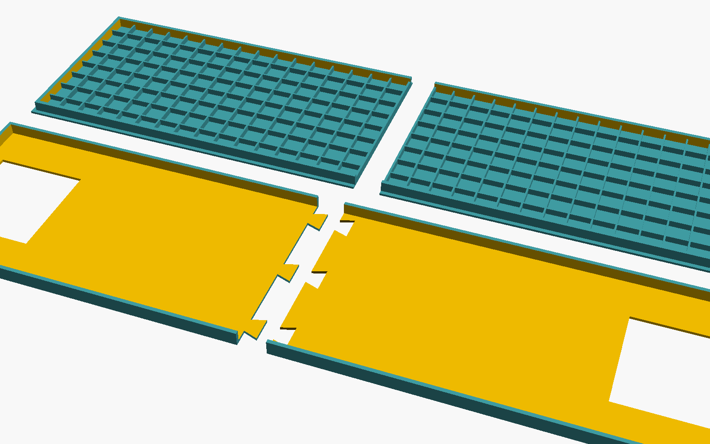
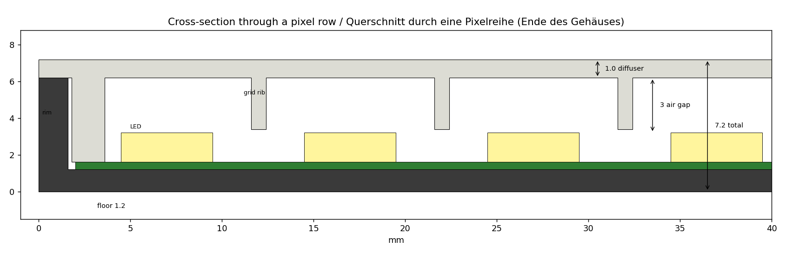

## English

**Outer size:** 324 × 84 × **8.4 mm** (assembled). Made for the flexible 8x32 panel with 5050 LEDs, **320 × 80 × 2 mm**.
**Measure your panel first** – sizes vary slightly between sellers; change `panel_l`, `panel_w`, `panel_t` at the top of
`matrix_case.scad` and export new STLs (OpenSCAD, free).

**Parts**

| File | What | Print orientation |
|---|---|---|
| `lid_left.stl` + `lid_right.stl` | top: closed 1 mm diffuser surface with a light grid underneath | as exported: smooth face down on the bed |
| `tray_left.stl` + `tray_right.stl` | bottom: holds the panel, cable openings at both ends and at the seam between the middle and the far dovetail (middle wires), 2.4 mm dovetail joint | as exported: floor on the bed |
| `lid.stl`, `tray.stl` | the same in one piece, only for printers with ≥ 330 mm bed | as above |

The halves are about 160–172 mm long and fit any common printer (e.g. 220 × 220 mm).

**How it works:** the tray holds the panel. The lid sits on the tray walls; its rim fits inside the walls and presses the
2.5 mm border of the panel flat onto the floor. Between the LEDs and the diffuser there is a 3 mm air gap, split into
10 × 10 mm cells by thin ribs, so every LED lights one sharp square pixel instead of a bright dot.

**Printing**
- **Lid:** white or natural (“transparent”) PLA or PETG. Layer height 0.2 mm → the diffuser is 5 layers. No supports.
  The bed side becomes the visible front: a smooth PEI sheet gives a glossy front, a textured sheet a matte one (diffuses better).
  Test first: print a 20 × 20 × 1 mm square and hold it over a lit LED – if the dot is still visible, raise `gap` to 4–5 mm.
- **Tray:** black PLA/PETG, so no light shines out of the back and sides. No supports.

**Assembly**
1. Glue the tray halves at the dovetails (superglue / CA) – or skip all gluing and use the clamp and end caps (see below).
2. Lay the panel in, LEDs up, with the wires going through the floor openings at the input end.
3. Put the two lid halves in place **on the tray** (it keeps them aligned) and glue them along the double-thick rib at the seam.
4. Press the lid on – it holds by friction. If it's too tight or loose, change `fit` (default 0.2 mm) and reprint the lid.
5. Fix the case in your acrylic housing with thin double-sided tape on the back.

**Joint:** the tray floor is 2.4 mm, so the dovetails are 2.4 mm high (larger than before: 12 mm head, 8 mm deep). Only the tray changed; the lid is identical to the previous version. `floor_t` sets the joint height – every extra 0.1 mm also makes the case 0.1 mm thicker, since the panel lies on the floor.

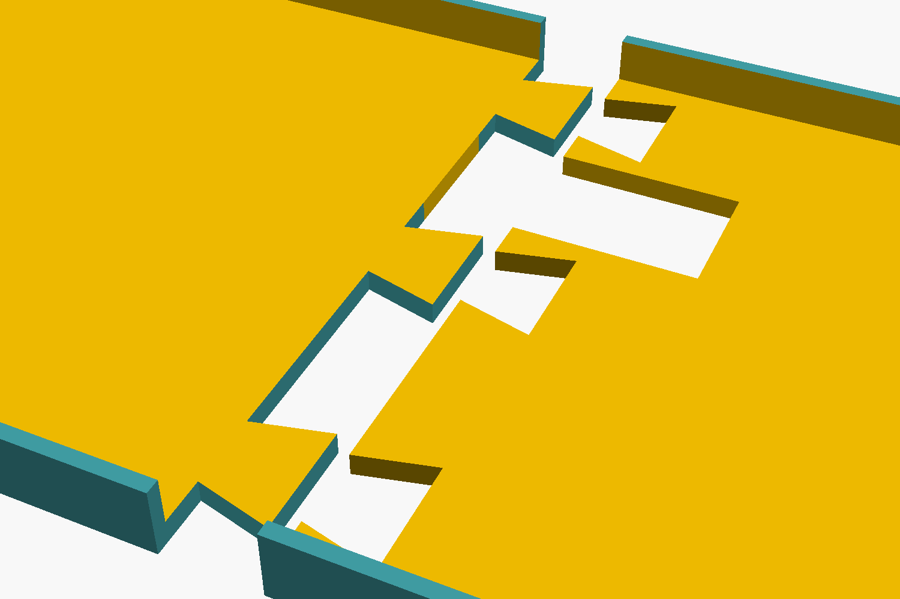

**Adjustable in `matrix_case.scad`:** `top_t` (diffuser thickness), `gap` (0 = thinnest possible, 5.4 mm total, but LEDs
show as dots), `grid` (on/off), `slot_*` (cable openings), `lid_split_x` / `tray_split_x` (where the halves are cut).

### Pico 2 case

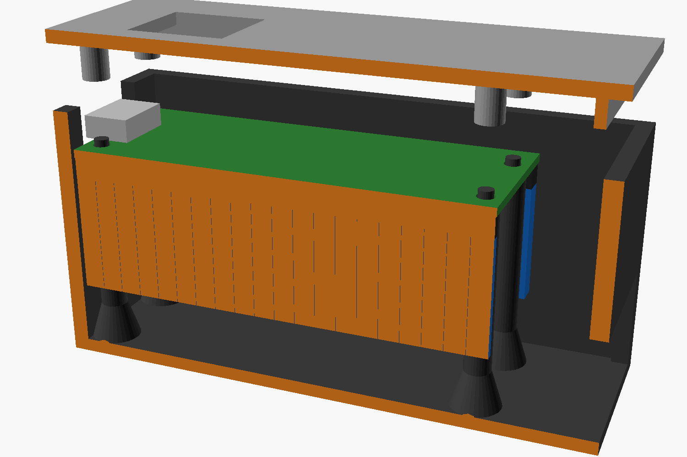

**Outer size:** 65.8 × 25.8 × 32.7 mm. For a Pico 2 with soldered pin headers **pointing down** and DuPont jumper
wires plugged onto them. The height comes from what hangs below the board: header plastic (2.5 mm) + DuPont housing
(14 mm) + about 7 mm so the wires can bend sideways. If your plugs are shorter or you use angled ones, lower `under_pcb`
in `pico_case.scad`.

- **`pico_tray.stl`**: the Pico sits on four standoffs with small pegs in its mounting holes. The wires leave through a
  20 × 12 mm slot in the end wall opposite the USB socket (`exit_side = true` adds a slot in the long side).
  The USB end has an opening big enough for the plug. 10 mm extra room behind the Pico (`extra_l`) for the small
  parts of the audio input.
- **`pico_lid.stl`**: four posts press the board down; a window above **BOOTSEL** and the LED.
- Print both without supports, as exported. Assembly: put the Pico in (USB towards the opening), press the lid on – it holds by friction.
- Checked in the model: the 40 header pins with DuPont plugs and the USB socket collide with neither part.
  The BOOTSEL window position (12.5 mm from the USB end) is taken from the board layout, not measured – it's large
  (12 × 11 mm) to allow for that.

### Clamp over the seam (`clamp.scad`)

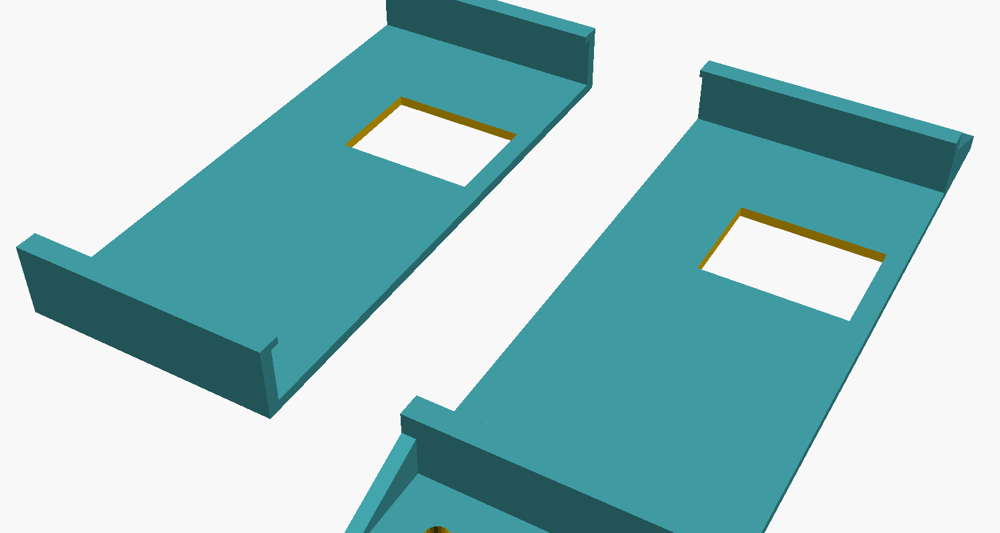
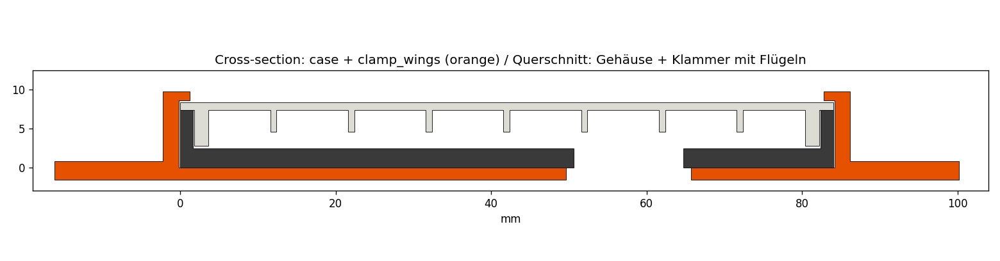

A 40 mm long C-profile that **slides over the assembled case from one end** and sits over the dovetails of the tray
and the seam of the lid. It grips the floor, both side walls and the outer 1.4 mm of the lid (outside the pixel area,
the first LEDs start 2 mm in), so it holds both seams together and stiffens the joint sideways. The middle cable
opening stays free.

| File | What |
|---|---|
| `clamp.stl` | plain clamp: adds 1.6 mm at the back and 1.2 mm at the front edges, only in this 40 mm section |
| `clamp_wings.stl` | with 14 mm side wings, gussets and four M3 holes: supports the case sideways and lets you screw it to the back of the acrylic housing |

Print lying on its back, as exported, no supports, in a strong material (PETG ideal). Push it on from one end and slide it
to the middle; it ends up centred over the tray dovetails (the lid seam is covered too). If it's too tight or too loose,
change `c_play` (0.2 mm). A drop of glue keeps it in place, but it isn't needed.

### End caps – assembly without glue (`clamp.scad`)

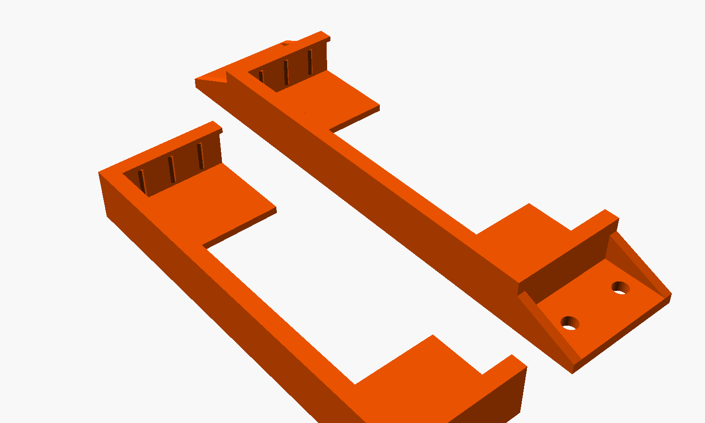
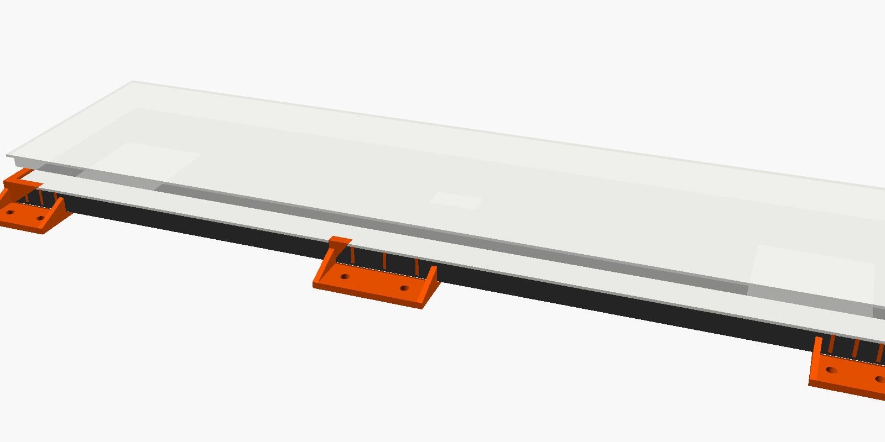

Each end cap slides onto one end of the assembled case. It closes the end with a 2 mm wall, grips floor and side walls,
and hooks 1.4 mm over the lid on three edges (again outside the pixel area). The cable opening in the floor stays free.
**Print two** – the same part fits both ends.

With **one middle clamp + two end caps** nothing needs glue: the dovetails hold the tray halves in the plane, the clamps
keep everything from lifting, and the end walls keep the lid halves from sliding apart. Small crush ribs on the inside
of all clamps (0.3 mm) deform a little when you push them on and keep them in place; the case adds 2 mm at each end
(328 mm total).

| File | What |
|---|---|
| `endcap.stl` | plain end cap |
| `endcap_wings.stl` | with side wings and four M3 holes, for screwing to the acrylic housing |

Too tight: set `crush = 0.15` (or `0`) in `clamp.scad`; too loose: `crush = 0.45`.

### Clip ring for the Pico case (`pico_clip.scad`, `pico_clip.stl`)

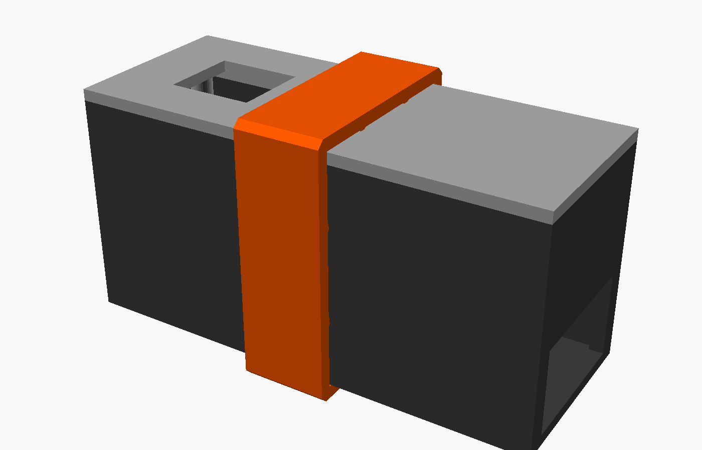

A closed 12 mm band that you push over the assembled Pico case from one end; it holds the lid on. Place it between the
BOOTSEL window and the wire exit (about 25–40 mm from the USB end). Small crush ribs (0.3 mm) on all four inner faces keep
it in place. Print lying flat, no supports; one ring is enough, a second one near the far end makes it extra solid.
Too tight: `r_crush = 0.15` (or `0`); too loose: `r_crush = 0.45`.

### Case for the VEML7700 light sensor (`sensor_case.scad`, `sensor_base.stl`, `sensor_lid.stl`)

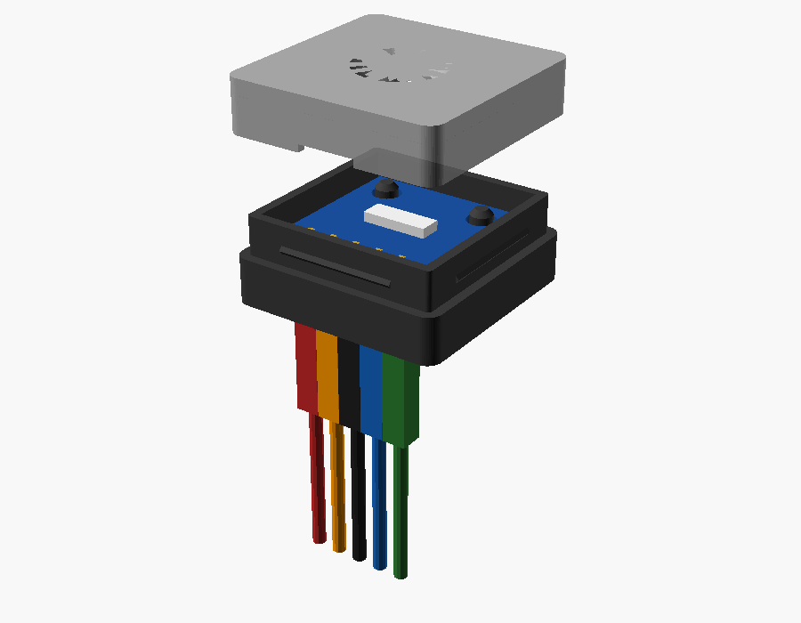
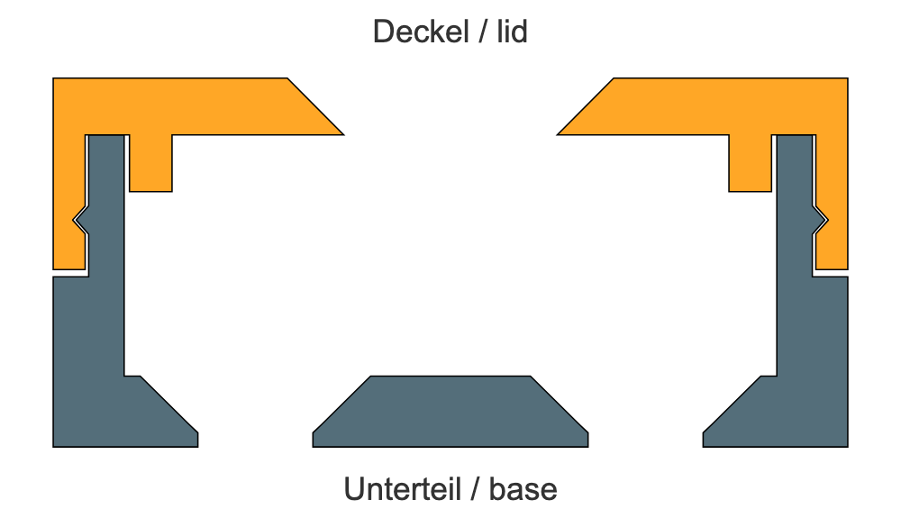

**Outer size 22.4 × 22.4 × 10.4 mm.** For the 17 × 17 mm VEML7700 module with the 5-pin header soldered in **from below**
(pins pointing down) and DuPont plugs on the pins. The sensor looks **up** (room light, it hardly sees the matrix); the
plugs leave straight down through a slot in the floor. Two pegs (2.3 mm, with a lead-in tip) go through the mounting holes (11 mm apart,
about 3 mm), two small pillars carry the header edge; the lid holds the board down and has a conical window over the
sensor. The lid is a **slip-on cap**: its 4 mm skirt goes over the thinner upper part of the base walls (flush outside)
and **snaps** over a bead on all four sides; an inner rim centres it. Two countersunk M3 holes in the floor (screw the base on before the board goes in), or use double-sided tape.

Assembly: plug the five DuPont wires onto the pins, thread them through the floor slot from above, put the board on the
pegs, push the lid on until it clicks (lift it with a fingernail at the notch in the skirt). Print the base upright and the lid top face
down (`sensor_lid.stl` is already turned over), no supports. Different module? Adjust `hole_edge`, `hdr_y` and
`sensor_xy` at the top of `sensor_case.scad`. Lid too tight or too loose: `snap = 0.25` / `snap = 0.45` (bead height); window closed by a thin skin (print the lid in
white/clear): `win_skin = 0.6`. STEP: `step/sensor_base.step`, `step/sensor_lid.step`, `step/assembly_sensor_case.step`
(generated by `sensor_case_to_step.py`).

### Light sensor on the middle clamp (`sensor_clamp.scad`, `clamp_sensor.stl`, `clamp_sensor_other_side.stl`)

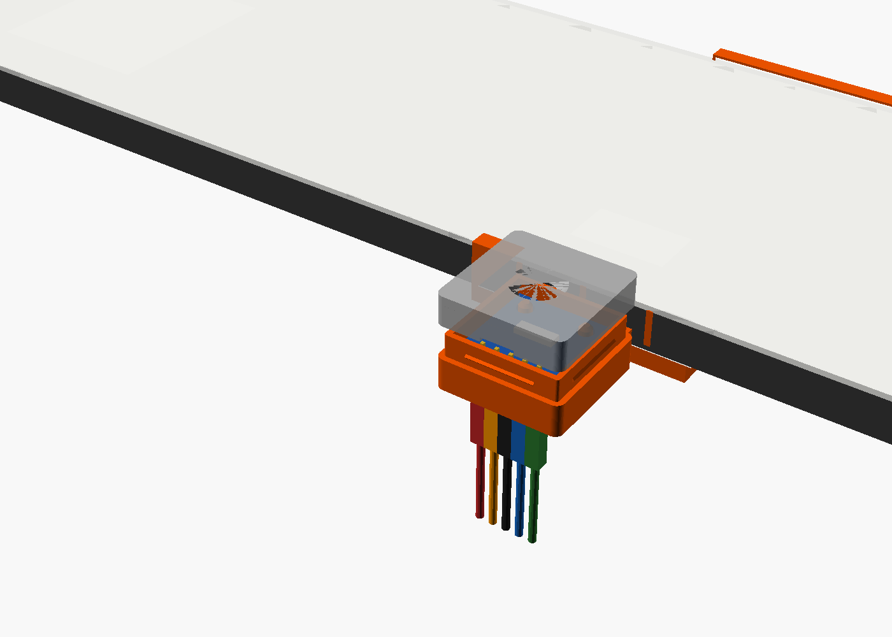
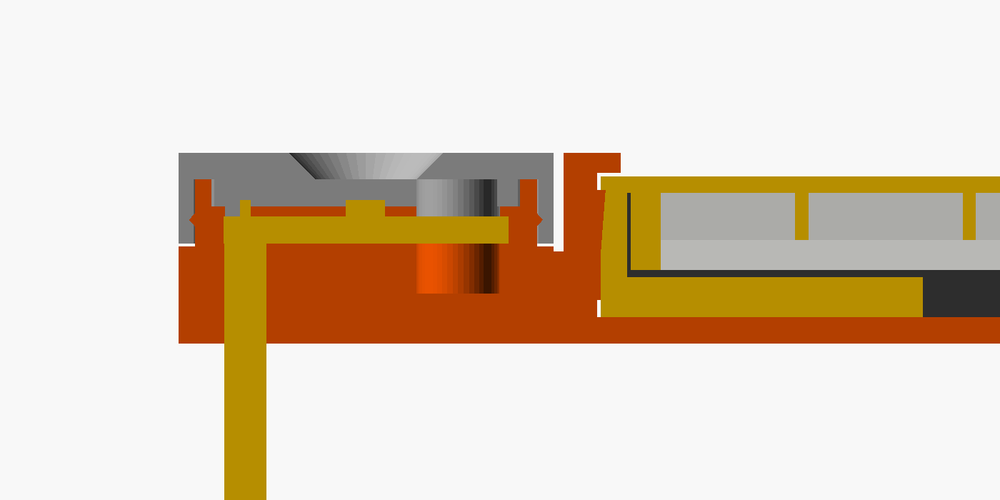

The plain middle clamp (no wings) with the sensor case built onto one long side, for a matrix mounted **flat** with no
room in front of it beyond the clamps. The board lies parallel to the matrix and the sensor looks **the same way as the
LEDs** (into the room); the DuPont plugs leave straight out through the back. The sensor case is exactly as tall as the
clamp (11.4 mm): its lid sits flush with the clamp hooks and sticks out 22.4 mm (+ 0.6 mm gap) beside the matrix case.
It is the same sensor case as above with a 1 mm thicker floor and no screw holes; **the lid is the same part**
(`sensor_lid.stl` – the one you already printed fits).

| File | What |
|---|---|
| `clamp_sensor.stl` | sensor on the long side with the middle cable opening of the tray (the side of the tray seam where the opening is) |
| `clamp_sensor_other_side.stl` | sensor on the other long side |

Print lying on its back like `clamp.stl`, as exported: clamp plate and sensor-case floor on the bed, no supports. Assembly:
plug the wires on, thread them through the floor slot, put the board on the pegs, snap the lid on, then slide the clamp
over the case from one end to the middle like the plain clamp. Other side or settings: `pod_side` (1/0) at the top of
`sensor_clamp.scad`; the other values come from `clamp.scad` and `sensor_case.scad`. STEP: `step/clamp_sensor.step`,
`step/clamp_sensor_other_side.step`, `step/assembly_case_with_sensor_clamp.step` (generated by `sensor_clamp_to_step.py`).

### Monitor mount (`monitor_mount.scad`, `monitor_mount.stl`, `monitor_knob.stl`, `monitor_pad.stl`)

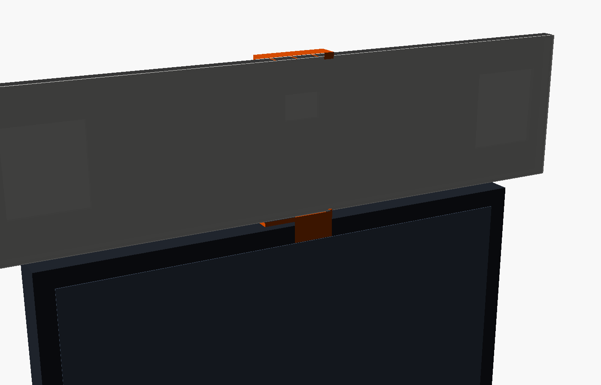
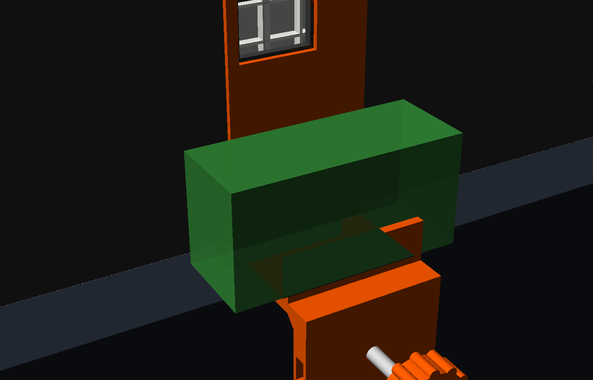
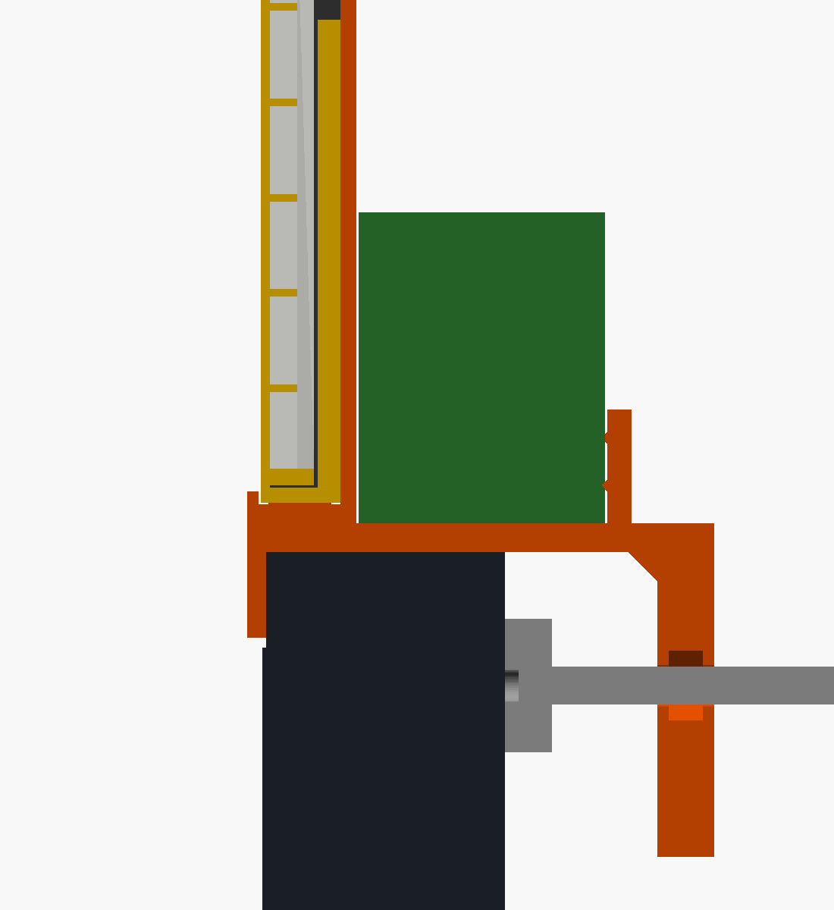

The middle clamp of the matrix case with a clamp for the top edge of a monitor: the matrix stands upright on the
monitor, LEDs towards the viewer. In front only a 2 mm lip reaches **9 mm** down over the monitor's top bezel; behind it
a hook with a thumb screw clamps monitors **10–40 mm** thick (measured where the screw presses, 14 mm below the top
edge). The Pico case lies in a cradle behind the matrix (crush ribs hold it, its ends stay free for USB and wires).
The plain middle clamp is replaced by this part; the end caps stay.

| File | What | Print |
|---|---|---|
| `monitor_mount.stl` | clamp + saddle + front lip + back hook + Pico cradle | standing on its end face, as exported, no supports; PETG, 4 walls |
| `monitor_knob.stl` | thumb knob, pressed onto the M4 hex head | flat |
| `monitor_pad.stl` | pressure pad, the screw cuts its thread into it | flat |

Hardware: M4x40 hex screw, M4 nut (slides into the slot from the open side), felt pads on the saddle and the lip
inside recommended. Assembly: slide the mount over the matrix case from one end to the middle like the plain clamp,
put the nut in, turn the screw in from behind, put the pad on its tip and the knob on its head, set the matrix on the
monitor and tighten by hand. The matrix stands with the middle cable opening at the top (it stays free); if the
picture is upside down, set `WS_FLIP_X` and `WS_FLIP_Y` in `src/config.h` and rebuild. Other monitor sizes:
`mon_min`/`mon_max`, `lip_down` (≤ 10), `hook_down`, `screw_y` at the top of the file. STEP: `step/monitor_mount.step`,
`step/monitor_knob.step`, `step/monitor_pad.step` (generated by `monitor_mount_to_step.py`).

### Monitor clips without screws (`monitor_clip.scad`, `monitor_clip.stl`, `monitor_clip_pico.stl`, `monitor_jaw.stl`)

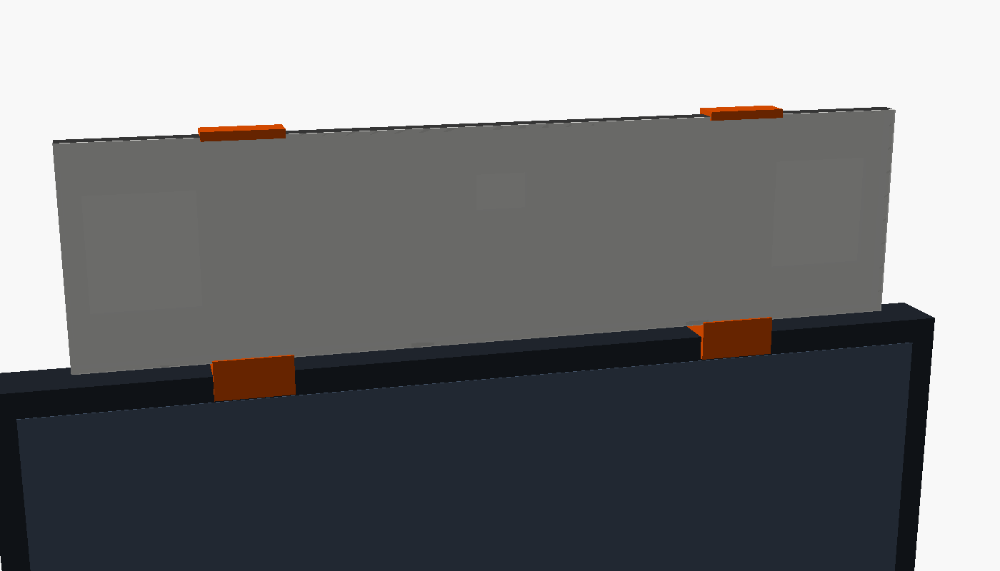
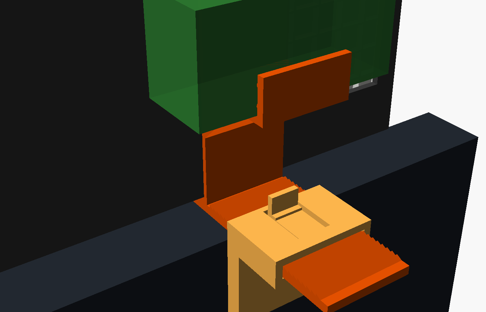
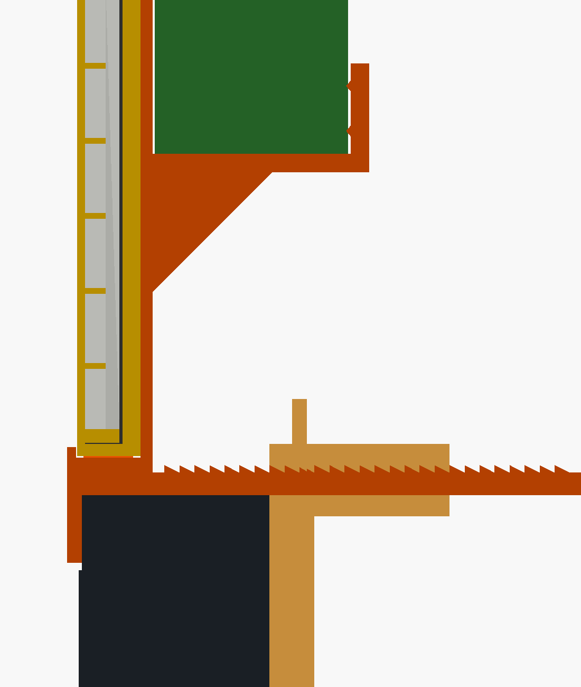

Two clips that slide onto the matrix case **in addition to** the middle clamp (e.g. the one with the light sensor,
which stays where it is): the matrix stands upright on the monitor. In front only a 2 mm lip reaches **9 mm** over the
bezel; behind, a jaw slides on a toothed rail and locks like a cable tie – push it against the monitor's back, it
clicks; lift the tab to release it. Monitors **10–40 mm** thick (at the top edge). One clip carries a cradle for the Pico
case at half the matrix height (the jaw's tab stays reachable below it).

| File | Count | Print |
|---|---|---|
| `monitor_clip_pico.stl` | 1 | standing on its end face, as exported, no supports; PETG |
| `monitor_clip.stl` | 1 | as above |
| `monitor_jaw.stl` | 2 | on its side, as exported, no supports; PETG (the tongue must spring) |

Assembly: pull off both end caps, slide one clip onto each end of the matrix case (about 5 cm in from the ends), put the
end caps back on. Slide a jaw onto each rail from the back end, tab up. Set the matrix on the monitor and push both jaws
towards the monitor until they sit tight. The sensor housing on the middle clamp stays at the top. Ratchet too stiff or
too loose: `tooth_h` (1.0), `tongue_t` (1.6) at the top of `monitor_clip.scad`. STEP: `step/monitor_clip.step`,
`step/monitor_clip_pico.step`, `step/monitor_jaw.step` (generated by `monitor_clip_to_step.py`).

### STEP files for CAD (Fusion, FreeCAD, Onshape ...)

`step/` contains the clamps as real solid bodies (not triangle meshes), so they can be edited in a CAD program:
`clamp.step`, `clamp_wings.step`, `endcap.step`, `endcap_wings.step` (same position and geometry as the STL files) and
`assembly_case_with_clamps.step` (simplified case as a 324 x 84 x 8.4 mm box plus all clamps in place - handy to check a
modified fit). Generated by `clamps_to_step.py` (CadQuery). The Pico clip ring: `pico_clip.step` and
`assembly_pico_case_with_clip.step` (simplified Pico case 65.8 x 25.8 x 32.7 mm), generated by `pico_clip_to_step.py`.

## Deutsch

**Außenmaß:** 324 × 84 × **8,4 mm** (zusammengebaut). Für das flexible 8x32-Panel mit 5050-LEDs, **320 × 80 × 2 mm**.
**Miss dein Panel zuerst aus** – die Maße schwanken je nach Händler leicht; dann oben in `matrix_case.scad` `panel_l`,
`panel_w`, `panel_t` anpassen und neue STLs exportieren (OpenSCAD, kostenlos).

**Teile**

| Datei | Was | Druckausrichtung |
|---|---|---|
| `lid_left.stl` + `lid_right.stl` | Oberseite: durchgehende 1-mm-Streufläche mit Lichtgitter darunter | wie exportiert: glatte Seite aufs Druckbett |
| `tray_left.stl` + `tray_right.stl` | Unterseite: hält das Panel, Kabelöffnungen an beiden Enden und an der Naht zwischen mittlerem und hinterem Schwalbenschwanz (mittlere Kabel), 2,4-mm-Schwalbenschwanz-Verbindung | wie exportiert: Boden aufs Druckbett |
| `lid.stl`, `tray.stl` | dasselbe einteilig, nur für Drucker mit ≥ 330 mm Druckbett | wie oben |

Die Hälften sind etwa 160–172 mm lang und passen auf jeden üblichen Drucker (z. B. 220 × 220 mm).

**Aufbau:** Die Unterseite hält das Panel. Die Oberseite liegt auf den Wänden; ihr Rand passt innen zwischen die Wände und
drückt den 2,5 mm breiten Rand des Panels flach auf den Boden. Zwischen LEDs und Streufläche liegen 3 mm Luft, durch
dünne Stege in 10 × 10 mm große Zellen geteilt, damit jede LED ein scharfes quadratisches Pixel statt eines hellen Punkts erzeugt.

**Drucken**
- **Oberseite:** weißes oder naturfarbenes („transparentes") PLA oder PETG. Schichthöhe 0,2 mm → die Streufläche hat 5 Schichten.
  Keine Stützen. Die Bettseite wird die sichtbare Front: glattes PEI ergibt eine glänzende, texturiertes eine matte Front
  (streut besser). Vorher testen: ein 20 × 20 × 1 mm Quadrat drucken und über eine leuchtende LED halten – ist der Punkt noch
  zu sehen, `gap` auf 4–5 mm erhöhen.
- **Unterseite:** schwarzes PLA/PETG, damit kein Licht nach hinten und zur Seite austritt. Keine Stützen.

**Zusammenbau**
1. Die Hälften der Unterseite an den Schwalbenschwänzen verkleben (Sekundenkleber) – oder ganz ohne Kleber mit Klammer und Endkappen (siehe unten).
2. Panel einlegen, LEDs nach oben, die Kabel am Eingangsende durch die Bodenöffnung führen.
3. Die beiden Deckelhälften **auf der Unterseite** auflegen (das richtet sie aus) und am doppelt starken Steg an der Naht verkleben.
4. Deckel aufdrücken – er hält durch Reibung. Zu stramm oder zu locker: `fit` ändern (Standard 0,2 mm) und den Deckel neu drucken.
5. Das Gehäuse mit dünnem doppelseitigem Klebeband auf der Rückseite im Plexiglas-Gehäuse befestigen.

**Verbindung:** Der Boden der Unterseite ist 2,4 mm dick, die Schwalbenschwänze sind also 2,4 mm hoch (und größer als vorher: 12 mm Kopf, 8 mm tief). Geändert hat sich nur die Unterseite; der Deckel ist identisch mit der vorherigen Version. `floor_t` bestimmt die Höhe der Verbindung – jedes zusätzliche 0,1 mm macht das Gehäuse auch 0,1 mm dicker, weil das Panel auf dem Boden liegt.

**Einstellbar in `matrix_case.scad`:** `top_t` (Dicke der Streufläche), `gap` (0 = so dünn wie möglich, 5,4 mm gesamt, aber
die LEDs erscheinen als Punkte), `grid` (Gitter an/aus), `slot_*` (Kabelöffnungen), `lid_split_x` / `tray_split_x` (Trennstellen).

### Pico-2-Gehäuse

**Außenmaß:** 65,8 × 25,8 × 32,7 mm. Für einen Pico 2 mit angelöteten Stiftleisten **nach unten** und aufgesteckten
DuPont-Kabeln. Die Höhe ergibt sich aus dem, was unter der Platine hängt: Kunststoff der Stiftleiste (2,5 mm) +
DuPont-Stecker (14 mm) + etwa 7 mm, damit die Kabel zur Seite abbiegen können. Sind deine Stecker kürzer oder gewinkelt,
`under_pcb` in `pico_case.scad` verkleinern.

- **`pico_tray.stl`**: Der Pico liegt auf vier Stützen mit kleinen Zapfen in seinen Befestigungslöchern. Die Kabel
  verlassen das Gehäuse durch einen 20 × 12 mm Schlitz in der Stirnwand gegenüber der USB-Buchse
  (`exit_side = true` ergänzt einen Schlitz in der Längsseite). Am USB-Ende ist eine Öffnung, groß genug für den Stecker.
  10 mm Platz hinter dem Pico (`extra_l`) für die kleinen Bauteile des Audioeingangs.
- **`pico_lid.stl`**: Vier Stifte drücken die Platine nach unten; ein Fenster über **BOOTSEL** und der LED.
- Beides ohne Stützen drucken, so wie exportiert. Zusammenbau: Pico einlegen (USB zur Öffnung), Deckel aufdrücken – er hält durch Reibung.
- Im Modell geprüft: Die 40 Stiftleisten-Pins mit DuPont-Steckern und die USB-Buchse kollidieren mit keinem Teil.
  Die Position des BOOTSEL-Fensters (12,5 mm vom USB-Ende) stammt aus dem Platinenlayout, nicht aus einer Messung –
  deshalb ist es großzügig (12 × 11 mm).

### Klammer über der Naht (`clamp.scad`)

Ein 40 mm langes C-Profil, das **vom Ende her über das zusammengebaute Gehäuse geschoben** wird und über den
Schwalbenschwänzen der Unterseite und der Naht des Deckels sitzt. Es umfasst Boden, beide Seitenwände und die äußeren
1,4 mm des Deckels (außerhalb der Pixelfläche, die ersten LEDs beginnen 2 mm weiter innen), hält so beide Nähte zusammen
und steift die Verbindung seitlich aus. Die mittlere Kabelöffnung bleibt frei.

| Datei | Was |
|---|---|
| `clamp.stl` | einfache Klammer: trägt hinten 1,6 mm und an den vorderen Kanten 1,2 mm auf, nur auf diesen 40 mm |
| `clamp_wings.stl` | mit 14 mm Seitenflügeln, Versteifungsdreiecken und vier M3-Löchern: stützt das Gehäuse seitlich ab und lässt sich an die Rückwand des Plexiglas-Gehäuses schrauben |

Auf dem Rücken liegend drucken, so wie exportiert, ohne Stützen, in einem festen Material (am besten PETG). Vom Ende her
aufschieben und bis zur Mitte schieben; dort sitzt sie mittig über den Schwalbenschwänzen (die Deckelnaht ist mit
abgedeckt). Zu stramm oder zu locker: `c_play` ändern (0,2 mm). Ein Tropfen Kleber hält sie an Ort und Stelle, nötig ist er nicht.

### Endkappen – Zusammenbau ohne Kleber (`clamp.scad`)

Jede Endkappe wird auf ein Ende des zusammengebauten Gehäuses geschoben. Sie schließt das Ende mit einer 2-mm-Wand ab,
umfasst Boden und Seitenwände und greift an drei Kanten 1,4 mm über den Deckel (wieder außerhalb der Pixelfläche).
Die Kabelöffnung im Boden bleibt frei. **Zweimal drucken** – dasselbe Teil passt an beide Enden.

Mit **einer Mittelklammer + zwei Endkappen** muss nichts geklebt werden: Die Schwalbenschwänze halten die Hälften der
Unterseite in der Ebene zusammen, die Klammern verhindern das Abheben, und die Stirnwände verhindern, dass die
Deckelhälften auseinanderrutschen. Kleine Quetschrippen innen an allen Klammern (0,3 mm) geben beim Aufschieben etwas
nach und halten die Teile fest; das Gehäuse wird an jedem Ende 2 mm länger (328 mm gesamt).

| Datei | Was |
|---|---|
| `endcap.stl` | einfache Endkappe |
| `endcap_wings.stl` | mit Seitenflügeln und vier M3-Löchern, zum Anschrauben im Plexiglas-Gehäuse |

Zu stramm: `crush = 0.15` (oder `0`) in `clamp.scad` setzen; zu locker: `crush = 0.45`.

### Klemmring für das Pico-Gehäuse (`pico_clip.scad`, `pico_clip.stl`)

Ein geschlossenes, 12 mm breites Band, das du vom Ende her über das zusammengebaute Pico-Gehäuse schiebst; es hält den
Deckel. Setz es zwischen BOOTSEL-Fenster und Kabelausgang (etwa 25–40 mm vom USB-Ende). Kleine Quetschrippen (0,3 mm)
an allen vier Innenseiten halten es fest. Flach liegend drucken, ohne Stützen; ein Ring reicht, ein zweiter nahe dem
anderen Ende macht es besonders stabil. Zu stramm: `r_crush = 0.15` (oder `0`); zu locker: `r_crush = 0.45`.

### Gehäuse für den Lichtsensor VEML7700 (`sensor_case.scad`, `sensor_base.stl`, `sensor_lid.stl`)

**Außenmaß 22,4 × 22,4 × 10,4 mm.** Für das 17 × 17 mm große VEML7700-Modul mit **von unten** eingelöteter 5-poliger
Stiftleiste (Pins nach unten) und aufgesteckten Dupont-Kabeln. Der Sensor schaut **nach oben** (Raumlicht, die Matrix
sieht er kaum); die Stecker gehen gerade nach unten durch einen Schlitz im Boden. Zwei Stifte (2,3 mm, mit angeschrägter Spitze) greifen durch
die Befestigungslöcher (Abstand 11 mm, ca. 3 mm groß), zwei kleine Säulen tragen die Kante mit der Stiftleiste; der
Deckel hält die Platine fest und hat ein kegelförmiges Fenster über dem Sensor. Er ist ein **Stülpdeckel**: Sein 4 mm
hoher Rand greift über den dünneren oberen Teil der Unterteil-Wände (außen bündig) und **rastet** auf allen vier Seiten
über einem Wulst ein; ein innerer Rand zentriert ihn. Im Boden zwei Senkbohrungen für M3
(Unterteil festschrauben, bevor die Platine hineinkommt) – oder doppelseitiges Klebeband.

Zusammenbau: die fünf Dupont-Kabel auf die Pins stecken, von oben durch den Bodenschlitz fädeln, Platine auf die Stifte
setzen, Deckel aufdrücken, bis er einrastet (an der Kerbe im Rand mit dem Fingernagel wieder abheben). Unterteil stehend, Deckel
mit der Oberseite nach unten drucken (`sensor_lid.stl` ist schon umgedreht), ohne Stützen. Anderes Modul? Oben in
`sensor_case.scad` `hole_edge`, `hdr_y` und `sensor_xy` anpassen. Deckel zu stramm oder zu locker: `snap = 0.25` / `snap = 0.45` (Höhe des Wulsts); Fenster mit dünner Haut
geschlossen (Deckel dann in Weiß/transparent drucken): `win_skin = 0.6`. STEP: `step/sensor_base.step`,
`step/sensor_lid.step`, `step/assembly_sensor_case.step` (erzeugt mit `sensor_case_to_step.py`).

### Lichtsensor an der mittleren Klammer (`sensor_clamp.scad`, `clamp_sensor.stl`, `clamp_sensor_other_side.stl`)

Die einfache mittlere Klammer (ohne Flügel) mit angebautem Sensorgehäuse an einer langen Seite – für eine **liegend**
montierte Matrix, vor der außer den Klammern kein Platz ist. Die Platine liegt parallel zur Matrix, der Sensor schaut
**in dieselbe Richtung wie die LEDs** (in den Raum); die DuPont-Stecker gehen gerade nach hinten raus. Das Sensorgehäuse
ist genau so hoch wie die Klammer (11,4 mm): der Deckel schließt bündig mit den Haken der Klammer ab und steht 22,4 mm
(+ 0,6 mm Spalt) neben dem Matrix-Gehäuse über. Es ist dasselbe Sensorgehäuse wie oben mit 1 mm dickerem Boden und ohne
Schraublöcher; **der Deckel ist dasselbe Teil** (`sensor_lid.stl` – der schon gedruckte passt).

| Datei | Was |
|---|---|
| `clamp_sensor.stl` | Sensor an der langen Seite mit der mittleren Kabelöffnung des Unterteils |
| `clamp_sensor_other_side.stl` | Sensor an der anderen langen Seite |

Wie `clamp.stl` auf dem Rücken liegend drucken, so wie exportiert: Klammerboden und Boden des Sensorgehäuses liegen auf dem
Druckbett, ohne Stützen. Zusammenbau: Kabel aufstecken, durch den Schlitz im Boden fädeln, Platine auf die Stifte, Deckel
aufschnappen, dann die Klammer wie die einfache vom Ende her über das Gehäuse bis zur Mitte schieben. Andere Seite oder
Maße: `pod_side` (1/0) oben in `sensor_clamp.scad`; die übrigen Werte kommen aus `clamp.scad` und `sensor_case.scad`.
STEP: `step/clamp_sensor.step`, `step/clamp_sensor_other_side.step`, `step/assembly_case_with_sensor_clamp.step`
(erzeugt mit `sensor_clamp_to_step.py`).

### Monitorhalterung (`monitor_mount.scad`, `monitor_mount.stl`, `monitor_knob.stl`, `monitor_pad.stl`)

Die mittlere Klammer des Matrix-Gehäuses mit einer Klemme für die Oberkante eines Monitors: Die Matrix steht aufrecht
auf dem Monitor, die LEDs zum Betrachter. Vorn reicht nur eine 2 mm dünne Lippe **9 mm** über den oberen Monitorrand nach
unten; hinten klemmt ein Haken mit Rändelschraube Monitore von **10–40 mm** Dicke (gemessen dort, wo die Schraube drückt,
14 mm unter der Oberkante). Das Pico-Gehäuse liegt in einer Mulde hinter der Matrix (Klemmrippen halten es, seine Enden
bleiben frei für USB und Kabel). Die einfache mittlere Klammer wird durch dieses Teil ersetzt; die Endkappen bleiben.

| Datei | Was | Druck |
|---|---|---|
| `monitor_mount.stl` | Klammer + Sattel + vordere Lippe + hinterer Haken + Pico-Mulde | auf der Stirnseite stehend, so wie exportiert, ohne Stützen; PETG, 4 Wände |
| `monitor_knob.stl` | Rändelknopf, wird auf den M4-Sechskantkopf gedrückt | flach |
| `monitor_pad.stl` | Druckplatte, die Schraube schneidet sich ihr Gewinde hinein | flach |

Material: M4x40-Sechskantschraube, M4-Mutter (wird von der offenen Seite in den Schlitz geschoben); Filzgleiter auf dem
Sattel und innen an der Lippe empfohlen. Zusammenbau: die Halterung wie die einfache Klammer vom Ende her bis zur Mitte
über das Matrix-Gehäuse schieben, Mutter einsetzen, Schraube von hinten eindrehen, Druckplatte auf die Spitze und Knopf
auf den Kopf stecken, Matrix auf den Monitor setzen und von Hand festziehen. Die Matrix steht mit der mittleren
Kabelöffnung nach oben (sie bleibt frei); steht das Bild auf dem Kopf, in `src/config.h` `WS_FLIP_X` und `WS_FLIP_Y`
setzen und neu bauen. Andere Monitore: `mon_min`/`mon_max`, `lip_down` (≤ 10), `hook_down`, `screw_y` oben in der Datei.
STEP: `step/monitor_mount.step`, `step/monitor_knob.step`, `step/monitor_pad.step` (erzeugt mit `monitor_mount_to_step.py`).

### Monitorklemmen ohne Schrauben (`monitor_clip.scad`, `monitor_clip.stl`, `monitor_clip_pico.stl`, `monitor_jaw.stl`)

Zwei Klemmen, die **zusätzlich** zur mittleren Klammer auf das Matrix-Gehäuse geschoben werden (z. B. die mit dem
Lichtsensor, die bleibt, wo sie ist): Die Matrix steht aufrecht auf dem Monitor. Vorn reicht nur eine 2 mm dünne Lippe
**9 mm** über den Monitorrand; hinten läuft ein Schieber auf einer Zahnleiste und rastet wie ein Kabelbinder – an die
Monitor-Rückseite schieben, er klickt ein; zum Lösen die Lasche anheben. Monitore von **10–40 mm** Dicke (an der
Oberkante). Eine Klemme trägt auf halber Matrixhöhe eine Mulde für das Pico-Gehäuse (darunter bleibt die Lasche
erreichbar).

| Datei | Anzahl | Druck |
|---|---|---|
| `monitor_clip_pico.stl` | 1 | auf der Stirnseite stehend, so wie exportiert, ohne Stützen; PETG |
| `monitor_clip.stl` | 1 | wie oben |
| `monitor_jaw.stl` | 2 | auf der Seite liegend, so wie exportiert, ohne Stützen; PETG (die Zunge muss federn) |

Zusammenbau: beide Endkappen abziehen, je eine Klemme von jedem Ende auf das Matrix-Gehäuse schieben (etwa 5 cm vom
Ende), Endkappen wieder aufstecken. Je einen Schieber von hinten auf die Zahnleiste schieben, Lasche nach oben. Matrix
auf den Monitor setzen und beide Schieber an den Monitor schieben, bis sie fest sitzen. Das Sensorgehäuse an der
mittleren Klammer bleibt oben. Rastung zu stramm oder zu locker: `tooth_h` (1,0), `tongue_t` (1,6) oben in
`monitor_clip.scad`. STEP: `step/monitor_clip.step`, `step/monitor_clip_pico.step`, `step/monitor_jaw.step` (erzeugt mit
`monitor_clip_to_step.py`).

### STEP-Dateien für CAD (Fusion, FreeCAD, Onshape ...)

`step/` enthält die Klammern als echte Volumenkörper (keine Dreiecksnetze), damit sie sich im CAD-Programm bearbeiten
lassen: `clamp.step`, `clamp_wings.step`, `endcap.step`, `endcap_wings.step` (gleiche Lage und Geometrie wie die STL-Dateien)
und `assembly_case_with_clamps.step` (vereinfachtes Gehäuse als Quader 324 x 84 x 8,4 mm plus alle Klammern an ihrem
Platz – praktisch, um eine geänderte Passung zu prüfen). Erzeugt mit `clamps_to_step.py` (CadQuery). Der Klemmring für das
Pico-Gehäuse: `pico_clip.step` und `assembly_pico_case_with_clip.step` (vereinfachtes Pico-Gehäuse 65,8 x 25,8 x 32,7 mm),
erzeugt mit `pico_clip_to_step.py`.
